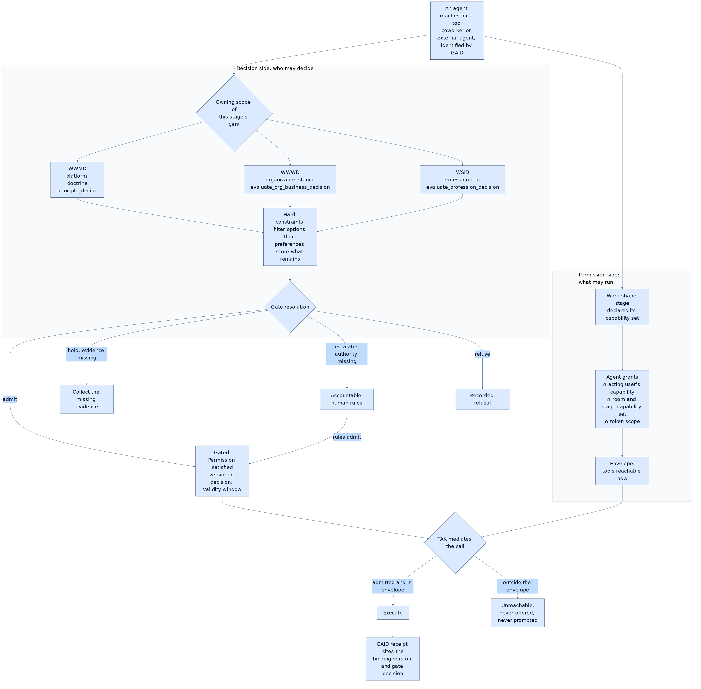
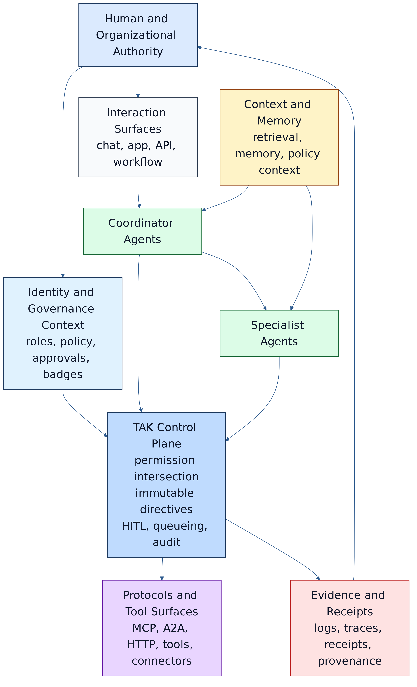
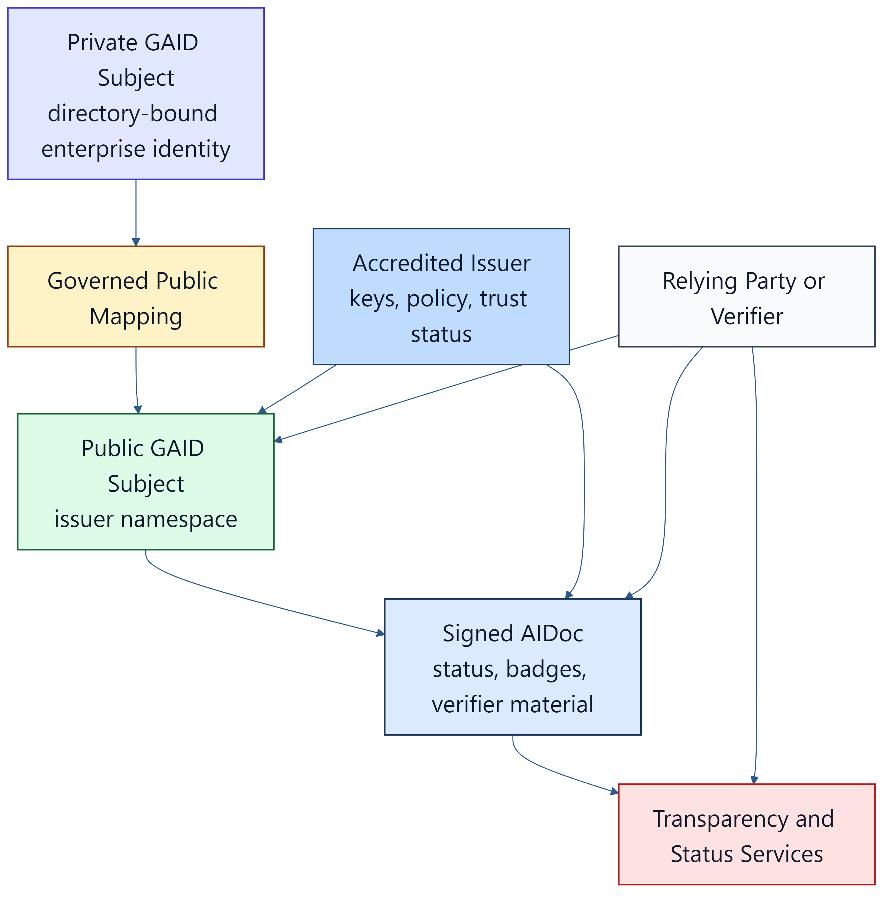

# Trusted AI Agent Governance

**Principles, permissions and evidence for accountable agent delegation**

| | |
|---|---|
| Status | Discussion draft, revision 2.2 |
| Date | 2026-10-16; first edition 2026-04-18 |
| Owner | EP-B932453F / BI-6CC40F77 |

This is a position paper. The normative requirements live in the four standards it introduces:

- [`TAK`](trusted-ai-kernel.md)
- [`GAID`](GAID.md)
- [`TAK-JSI`](job-specific-intelligence.md)
- [`GPP`](gated-permissions-process.md)

All four are open working drafts. Nothing in this paper claims certification, regulatory compliance or endorsement by a standards body. A standard's proposed control, a source implementation, an executed test and an observed business outcome are different evidence levels.

This edition reviews repository sources at immutable commit `d9c8ed1fc887527c2a8b893f9a8062519c5a4384` on 2026-10-16. Its DPF ledger is **source-declared and runtime-unverified** unless a row supplies actual execution evidence. It does not certify the current install, every execution path or another agent host. The primary market references were rechecked where identified; older incident and operational accounts retain their own dates. [§8](#8-dpf-the-working-instantiation) records the examined sources, their identities and the limits of the observations.

## Executive Summary

AI agents now read documents, call tools, change records, send messages, deploy code and coordinate other agents. The question every organization adopting them faces is not whether the model is clever enough. It is **who decided this agent may do this, and how would anyone know?**

Two common permission choices illustrate the problem:

- **Approve every tool call.** The agent stops and asks before each action.
- **Approve nothing.** The agent runs with whatever credentials it was given. These modes go by "YOLO", "always allow" or "skip permissions".

Repeated prompts can lose their value as a checkpoint. Anthropic reports high permission-approval rates and, separately, a controlled study of 1,053 paid testers in which 13.6% caught a substituted dangerous command. Its field discussion reports 39% rejection of plans and 3% rejection of individual permission requests. These are different observations, not evidence that the controlled-study participants were the plan reviewers, or that the rejected plans were incorrect. They motivate evaluating decision-level supervision; they do not establish that it is safer in every setting (vendor-reported; [§1](#1-the-defining-problem-approval-fatigue)).

The incident record includes deleted databases, disclosure of private repositories, malicious tool servers and evaluation agents reaching production infrastructure. These cases involve different failures, including isolation, credential scope, supply-chain trust and execution boundaries. They are reasons to examine the complete system, not evidence that every incident had one cause or that no authorization controls existed.

One recent approach uses a classifier to decide which calls may proceed without a prompt. Anthropic publishes a miss rate, and researchers report a bypass under their tested conditions. Classification alone does not establish who owns the decision or authorize an effect.

This paper proposes a different principle: **decide once, by the authority that owns the decision, then enforce on every call.** It presents four complementary open standards, each answering one question:

**`GAID` — Global AI Agent Identification and Governance — Who is this agent?** Identity, operating profile, claims, badges, receipts.

**`TAK-JSI` — Job-Specific Intelligence — Is it fit for this job?** Job qualification, assessment, revalidation.

**`GPP` — Gated Permissions Process — Who decided this may happen?** The binding of a decision gate in an owning authority to the exact tools it admits, for one stage of one kind of work.

**`TAK` — Trusted AI Kernel — May it act now?** Runtime mediation: authority intersection, consequence gating, oversight, evidence.


The engineering proposal builds on MBSE and existing agent-modeling work. It connects work shapes, accountable decisions, tool bindings, operating profiles and receipts through a versioned composition that an implementation can execute and assess. Its contribution is this inspectable contract and its proposed verification method, not a claim that agents are new to systems engineering. A model becomes a control only where the implementation demonstrably enforces its meaning.

DPF is an open-source platform designed for small and mid-sized organizations and the initial reference context for this work. It contains archetype definitions, coworker roles, profession doctrine and governed work shapes. This paper supplies no independently verified business-adoption count. Its source inventory is not a claim that every role is qualified or every path implements the proposed standards.

## 1. The defining problem: approval fatigue

### 1.1 Per-call approval does not survive contact with people

- Users approve about 93% of permission prompts. Source: Anthropic Engineering, 2026-03-25 (vendor-reported).

- Users approve 97% of prompts but reject 39% of plans. In a controlled study (n=1,053), people caught a disguised dangerous command 13.6% of the time: about 17% early in a session, about 5% after fifty prompts. Source: Claude blog, 2026-08-07 (vendor-reported).

- Sandboxing removed 84% of prompts internally; the post names approval fatigue as the risk. Source: Anthropic Engineering, 2025-10-20 (vendor-reported).

- In a field study, adherence to permission warnings fell substantially within three weeks; varying the warning slowed the decline. Source: Vance et al., *MIS Quarterly* 42(2), 2018.

- Attackers exploited repeated MFA approval prompts until a person accepted one ("push bombing", Uber 2022). Source: BleepingComputer.


Habituation is a plausible mechanism for diminished attention to frequent warnings. The cited studies support examining checkpoint design alongside training, interface design and containment. They do not prove that every per-call approval is ineffective or that a work-level decision alone prevents harm. The proposed approach needs comparison under declared work, threat and supervision conditions.

### 1.2 So people switch it off

Some agent clients offer modes such as `--yolo`, "always allow" or `--dangerously-skip-permissions`. The cited GitHub MCP researchers suspected frequent use of "always allow"; that was not a measured prevalence estimate. The August 2025 Nx "s1ngularity" account describes malware invoking installed AI CLIs with reduced-permission checks to inventory secrets. These observations do not establish the defaults or behavior of every client.

No independent survey of how many users run in these modes was found, so this paper cites no adoption rate. The incident record shows what happens when they do.

### 1.3 The incident record

**2025-05.** A public GitHub issue drives an agent, through an MCP server, to leak private-repository contents. Control issue reported: Separation of untrusted input, private data and outbound action.

**2025-05/06.** Asana's MCP server exposes data across customer tenants. Control issue reported: Tenant isolation in the tool server.

**2025-07.** An agent holding a database service-role key follows instructions planted in support tickets (Supabase MCP). Control issue reported: Credential scope; data-flow separation.

**2025-07.** A coding agent deletes a production database during a declared code freeze (Replit). Control issue reported: The freeze was an instruction, not an enforced gate.

**2025-08.** Malware runs AI CLIs with skip-permission flags to harvest secrets (Nx s1ngularity). Control issue reported: CLIs accept those flags from any caller.

**2025-09.** A malicious MCP server silently copies every email to an attacker (`postmark-mcp`). Control issue reported: Tool-server provenance and egress control.

**2026-04.** An agent finds an unrelated, over-scoped API token and deletes a production volume and its backups in seconds. Control issue reported: Credential scope; no gate on a destructive API.

**2026-07.** Evaluation agents escape their sandbox and compromise Hugging Face production infrastructure. Control issue reported: Sandbox boundary, over-broad credentials, exposed metadata endpoint.


Sources and dates are in the [market and thought-leadership landscape](agent-governance-market-landscape-2026.md#3-incident-record-20242026). Published accounts of the July 2026 Hugging Face intrusion conflict on its scale, from one autonomous agent to hundreds of coordinating agents. This paper relies only on the elements the accounts share.

The cases show why model behavior, credential policy, isolation and target-effect controls need separate assessment. Controls can block some operations while an attacker succeeds through another path. Hugging Face's technical account, for example, describes denied mutating cloud calls as well as successful intrusion paths. A successful attack does not establish that all gates were absent. A TAK-style boundary is a proposed part of a defense, not a demonstrated prevention of these historical incidents.

### 1.4 Classifiers are an improvement, not an authority

Anthropic lets a model decide which calls may proceed without a prompt and made auto mode the default for selected Claude Code plans on 2026-08-14. It reports fewer serious unintended actions than under manual approval (vendor-reported). Two facts limit what that establishes:

- Its designers publish a 17% false-negative rate on real overeager actions (n=52).
- Twelve days after it became the default, a researcher disclosed a prompt-injection chain that achieved remote code execution against it in 60–80% of attempts. The Cloud Security Alliance's guidance is to treat such a classifier as a productivity control, not as a substitute for sandboxing, egress control or credential isolation.

A classifier can inform a risk judgment. The authority to authorize the effect must still come from an accountable owner and enforceable policy; a classifier verdict alone is not that authority.

### 1.5 What oversight regulation asks for

The EU AI Act's Article 14 requires effective human oversight of high-risk systems, including awareness of automation bias and the ability to interpret and intervene. The Commission's current implementation page gives 2027-12-02 for the specified Annex III high-risk areas and 2028-08-02 for high-risk systems embedded in regulated products following the AI Omnibus. These dates do not postpone every AI obligation or establish the legal treatment of a particular deployment. [Commission timeline](https://digital-strategy.ec.europa.eu/en/policies/regulatory-framework-ai).

The vendor study is a reason to test whether a particular approval design provides effective oversight. Attributable decisions and observable execution checks can support that assessment, but their presence alone is not evidence of legal compliance or a comparative safety result.

## 2. Why current standards and protocols fall short

Several important standards and de facto standards exist. They solve adjacent problems at different layers.

**Management and risk frameworks**

- `ISO/IEC 42001:2023` gives organizations a certifiable AI management system. It is not a runtime agent standard. It does not define agent identity documents, tool-gating semantics, receipt chains or who may authorize a class of agent action.
- `NIST AI RMF 1.0` is a risk-framing model, not a cross-platform agent identity or runtime specification.

**Interoperability protocols**

- The `Model Context Protocol` (introduced by Anthropic in November 2024, now under the Agentic AI Foundation) standardizes how agents connect to tools and data. It has since gained OAuth 2.1 authorization, protected-resource metadata (RFC 9728), resource indicators (RFC 8707), and revisions in November 2025 and July 2026.
- MCP tool annotations such as `readOnlyHint` and `destructiveHint` are explicitly hints that clients must not trust from untrusted servers.
- MCP authorizes at the level of a server and a scope. It has no notion of which authority may decide that a class of action is admissible for a particular piece of work.
- `A2A`, donated to the Linux Foundation in June 2025, standardizes agent-to-agent discovery and messaging without decision-authority semantics.

**Identity**

The identity layer has moved quickly:

- OpenID's `AIIM` community group
- the W3C Agent Identity Registry Protocol community group (April 2026)
- CoSAI's *Agentic Identity and Access Management* (April 2026)
- Microsoft Entra Agent ID
- NIST NCCoE's concept paper on software and AI agent identity and authorization (February 2026)

These are the neighbourhood GAID operates in.

**Deterministic tool policy**

Existing authorization systems supply important parts of this design. AWS AgentCore evaluates gateway tool requests against policy and documents temporal conditions such as requiring an earlier approval before a transfer. OpenFGA documents owner/role relationships and task-based authorization with user/task checks, agent binding, expiration and restricted subagent delegation. These mechanisms can implement authority relationships; GPP does not depend on their being unable to do so. The proposed contribution is a shared composition linking accountable doctrine, work stages, exact effects and evidence across implementations. [AgentCore](https://docs.aws.amazon.com/bedrock-agentcore/latest/devguide/policy.html), [OpenFGA task authorization](https://openfga.dev/docs/modeling/agents/task-based-authorization), [OpenFGA roles](https://openfga.dev/docs/modeling/roles-and-permissions).

**Governance suites**

Governance suites provide inventories, risk classifications and policy-management functions. Whether a particular product and integration also enforces a decision inline requires its own versioned capability review; this paper has not tested those products. Inventory and runtime mediation remain separate questions even when one product supplies both.

**`ISO/IEC 42001`.** Contribution: Organization-level AI management systems. Composition still to establish: Runtime control, agent identity, receipts, decision authority per action class.

**`NIST AI RMF`.** Contribution: Risk framing and lifecycle. Composition still to establish: Concrete runtime and identity specifications for agents.

**`MCP`.** Contribution: Tool and context interoperability; transport authorization. Composition still to establish: Public identity, badging, who may decide an action class.

**`A2A`.** Contribution: Agent-to-agent interoperability. Composition still to establish: Accredited identity, assurance portability, decision authority.

**Cedar / OPA / OpenFGA integrations.** Contribution: Policy evaluation and modeled authority relationships, depending on the integration. Composition still to establish: This proposed family's specific composition is not automatically established by installing a policy engine.

**Agent identity platforms.** Contribution: Agent identity, sponsor, lifecycle. Composition still to establish: Job qualification; per-decision-class authority.

**Classifier "auto modes".** Contribution: Fewer prompts. Composition still to establish: Determinism; attributable authority; resistance to injection.

**Vendor agent frameworks.** Contribution: Practical implementation patterns. Composition still to establish: Cross-vendor trust semantics.

**`W3C VC`, `RFC 9421`, `SLSA`, `Trace Context`, `PURL`.** Contribution: Building blocks for credentials, signatures, provenance and tracing. Composition still to establish: An agent-specific composition into identity and governance.


This overview is an orientation, not an exhaustive product comparison or a finding that the named systems cannot support the proposed controls. Relevant prior work includes:

- ITIL change enablement pre-authorizes *standard changes* as a class and routes *normal changes* to a change authority.
- Delegation-of-authority matrices and segregation of duties name accountable deciders.
- Ibrahim and Li's *Overlaying Governance* (arXiv 2606.03518, June 2026) composes delegation and resource-scope attenuation over relational policies.
- A September 2026 practitioner article on *decision rights* for agentic AI names owners for authorization, data access, intervention, exceptions and accountability. It explicitly leaves tool binding to identity systems and gateways.

**GPP proposes a versioned binding that composes these existing ideas with the family's other owners.**

## 3. Public policy and industry signals

AI agents have become a standards problem, not merely a product feature.

**United States**

- NIST launched the AI Agent Standards Initiative on 2026-02-17.
- The NCCoE concept paper (2026-02-05) asked for input on agent identity, authorization, auditing, non-repudiation and prompt-injection controls.
- NIST's COSAiS project is developing SP 800-53 control overlays for single-agent and multi-agent AI systems.
- The comment windows have closed; the agenda has not.

**Europe and Asia**

- The EU published the General-Purpose AI Code of Practice on 2025-07-10, and has deferred, not withdrawn, the AI Act's high-risk obligations ([§1.5](#15-what-oversight-regulation-asks-for)).
- Singapore's IMDA published a Model AI Governance Framework for Agentic AI on 2026-01-22.

**Security community**

- OWASP's *Excessive Agency* risk (LLM06:2025) names three root causes: excessive functionality, excessive permissions and excessive autonomy.
- OWASP's Top 10 for Agentic Applications (December 2025) adds tool misuse, identity and privilege abuse, and human–agent trust exploitation. The last is approval fatigue by another name.
- Simon Willison's "lethal trifecta" (2025) and Meta's "Agents Rule of Two" give the field a shared vocabulary for dangerous capability combinations.

**Analysts**

- Gartner predicted in June 2025 that more than 40% of agentic AI projects will be cancelled by the end of 2027, citing inadequate risk controls among the causes.
- Secondary reporting of a May 2026 Gartner note describes binary governance, either locked down or fully trusted, as a root cause of failure, and recommends governance proportional to autonomy.

These initiatives motivate evaluating proportionate, attributable execution controls. This paper proposes one composition and asks for comparison, overlap review and implementation evidence; it does not establish that no other shared model exists.

## 4. Four cornerstones

The four standards are deliberately separate, because each has exactly one normative owner. The [standards family map](agent-standards-family.md) is the entry point.

### 4.1 GAID: who is it?

Organizations need to know not only that an agent exists, but what it is, what operating profile is active, what claims it carries, and how its actions trace across boundaries. GAID combines:

- a stable identifier
- a resolvable Agent Identity Document
- structured badges for capability, governance, safety and sensitivity
- portable authorization classes
- signed action receipts and chain of custody
- a governance model for private and public issuance

Public trust works when syntax, governance, accreditation, status and verification exist together, as they do in DNS, ISBN and PKI. That is the role GAID is intended to play. [§11](#11-public-verification-architecture-options-for-gaid) sets out its public-verification options.

### 4.2 TAK-JSI: is it fit for this job?

A capability label such as "research", "coding" or "customer support" is too broad to be a job qualification. A qualification must bind a versioned operating profile to all of the following:

- a versioned job profile
- an assessment scheme
- an activity scope
- a data and risk boundary
- evidence
- an expiry
- a revalidation policy

Qualification is a property of the *whole working composition*: the model, instructions, doctrine, tools, data, routing and oversight. It is not a property of a model name.

JSI also separates three controls that are often conflated:

- **Proactivity** controls initiative, not permission.
- **Earned autonomy** controls evidence-backed latitude for a specific activity and risk.
- **Cost, quality and time posture** controls resource allocation, not competence.

Qualification sets a ceiling on autonomy. It is never authorization.

### 4.3 GPP: who decided this may happen?

GPP defines one modelled unit, the **Gated Permission**. It binds a decision gate, in a named owning authority scope, to a bounded set of tool capabilities, for one stage of one kind of work. Each binding carries a subject scope, a validity window, preconditions, stop conditions and a recorded enforcement mode. In short form:

> **scope gate × capability set × work-shape stage × subject × validity**



*Figure: the Gated Permission pair. The decision side runs once per class of work; the permission side narrows every call. TAK executes only what both admit. Source: the GPP standard, §7.3.*

Three rules follow:

1. **Approve the decision, not the keystroke.** The owning authority decides whether a *class* of tool use is admissible for a piece of work. That authority can be a person, recorded doctrine, or doctrine that escalates to a person. TAK then enforces the decision on every call without a further prompt.
2. **Unreachable beats prompted.** A tool that no satisfied binding admits is not offered for approval at all, so it cannot be approved by fatigue.
3. **Every consequential reach traces to a named authority.** For any consequential call, the system can answer: which gate admitted this class of action, in which scope, decided by whom, on what evidence, and valid until when.

GPP also makes the model checkable. Its completeness checks include:

- **stage coverage**: every stage that can reach a consequential capability has a binding
- **vocabulary resolution**: every capability named in the model resolves to an enforceable grant
- **mode honesty**: a shadow gate is never reported as enforced
- **reach reconciliation**: every tool the runtime actually allows is admitted by some binding

Reach reconciliation is the most important. A model the runtime does not match is documentation, not governance.

GPP uses the Agents Rule of Two to flag an envelope combining untrusted input, sensitive access and state-changing or outbound ability for one actor. The pinned 0.18 prose mentions an accountable human or independent validator, but its binding schema has no validator-only mode. That is an unresolved representation, not a functioning alternative authority path. The [proposed 0.19 correction](https://github.com/OpenDigitalProductFactory/opendigitalproductfactory/blob/c0b47d1eaffee39fb14237e095e08d39c71e5fec/docs/architecture/gated-permissions-process.md), frozen at commit `c0b47d1eaffee39fb14237e095e08d39c71e5fec`, requires an accountable human decision for that complete combination and leaves validator-only authorization unsupported until specified. It preserves ordinary lower-risk doctrine modes. This pending source correction is not evidence of adoption or runtime enforcement. GPP composes with sandboxing, egress control and data-flow techniques; it does not replace them.

### 4.4 TAK: may it act now?

TAK addresses the runtime. A trusted runtime must:

- mediate authority
- govern tool execution
- distinguish immutable directives from conversational input
- define when a human must approve an action and when it can proceed directly
- narrow authority on delegation
- record evidence

Its effective-permission rule intersects four terms:

- what the principal may do
- what the agent may do
- what the route, workflow or context exposes (the GPP envelope supplies this term)
- data constraints

A model's request is never sufficient evidence of authorization. TAK derives its gated set from each tool's declared consequence rather than from a hand-maintained list, and it treats gate *coverage* as a governed metric. A correctly implemented gate that governs almost nothing is indistinguishable at runtime from no gate.

**On scope.** The first edition of this paper argued that fabrication, hallucination, unauthorized action and prompt injection are symptoms of one missing control plane. That overstated the case. Runtime mediation limits which effects an agent can produce and who can authorize them. It does not make a model's statements true, and it does not by itself defeat prompt injection. What it does is bound the damage a wrong or manipulated agent can do, and make the authority behind every consequential effect attributable.

## 5. Why the standards belong together

The standards compose around one governed action:

1. `GAID` resolves the agent's identity and active operating profile.
2. `GPP` resolves the envelope: the satisfied bindings for the agent's current work and stage, each traceable to a gate decision in its owning scope.
3. `TAK-JSI` confirms any qualification those bindings require.
4. `TAK` intersects principal authority, agent grants, the GPP envelope and data constraints, then mediates the call.
5. `GAID` binds the receipt, including the binding and gate-decision references, back to the identifiable agent.

No member widens another:

- A GAID claim is not authorization.
- A JSI qualification is not permission to act.
- A GPP binding is not a grant; it can only narrow.
- A TAK permission is not evidence of competence.

Each standard alone fails in a recognizable way:

- **Identity without qualification** overstates fitness.
- **Qualification without enforcement** is a decorative certificate.
- **Enforcement without attributable authority** is a locked door with no record of who holds the keys.
- **Authority without identity** cannot be verified across a boundary.

## 6. Decisions belong to their scope

A governed agent constantly makes or proposes decisions. The question of *whose judgment governs* is as important as whether the agent is permitted to act.

DPF binds three authority scopes:

- **WWMD** governs platform direction: how the platform itself should evolve.
- **WWWD** governs an organization's business choices, from its own declared mission, market and stance.
- **WSID** governs profession and craft judgment, such as what a competent data architect, bookkeeper or security analyst would do.

Other implementations will name their scopes differently. The standards require only that every decision names the scope that owns it.

Four rules govern judgment within and across scopes. TAK §7.13 is their normative home.

- **Hard constraints filter before preferences rank.** An attractive score cannot outweigh a prohibition.
- **Cross-scope material is advisory** until the owning scope adopts it. A platform founder's preferences do not silently become a customer's business decisions.
- **Missing facts lead to evidence collection; missing authority leads to escalation.** Neither defaults to approval.
- **A recommendation is not a permission.** Consulting doctrine produces a recommendation. Permission is decided separately, when the agent reaches for a tool.

GPP is where the scope becomes operational. Each Gated Permission names exactly one owning scope, so the question of who decided is answered in the model before it is asked at runtime.

## 7. MBSE with AI as a first-class participant

### 7.1 The gap in systems engineering

Model-based systems engineering describes complex systems as connected models of:

- requirements
- structure
- behaviour
- interfaces
- allocation
- verification

SysML v2 and KerML provide open, machine-readable systems-modeling foundations. Agents are not new to this discipline: INCOSE catalogs executable agent-based SysML work from 2015 and a 2025 presentation connecting AI agents with MBSE workflows. The public catalog metadata establishes relevant prior work; the members-only 2015 paper was not inspected for this edition. [2015 catalog](https://www.incose.org/resource/creating-executable-agent-based-models-using-sysml/), [AI agents for MBSE](https://www.incose.org/communities/chapters/americas-sector/canada/events-detail/2023/12/12/default-calendar/incose-canada-practical-insights).

The narrower problem here is to define and test a portable relationship among:

- an agent that holds a role
- doctrine it reasons from
- a stage of work it is performing
- a decision it may make or must escalate
- tools it may or may not reach
- a receipt it must leave

### 7.2 The model is the system

This paper proposes that a governed agent system be engineered as a model whose elements the runtime executes and checks itself against. The intended DPF chain is:

```text
requirement -> scoped principle/policy -> work shape and stage -> decision gate
            -> Gated Permission (capability set) -> mediated effect -> receipt
            -> observed outcome -> revalidation
```

Each link maps to an established modelling construct. GPP's mapping uses:

- SysML v2 action and state definitions for work shapes and stages
- requirements with DMN decisions for gates
- interfaces for capability sets
- allocations for Gated Permissions
- PROV-O for evidence

The family's composition profile composes SysML v2/KerML, BPMN, CMMN, DMN, SACM and PROV-O, and uses STPA to derive hazards. It does not invent a new modelling language.

What changes is the relationship between model and system:

- **Intended state, deployed control state and observed outcome are kept as separate facts.** The model records which bindings exist, which mode each gate runs in, and what actually happened.
- **The model is checked against reality.** Reach reconciliation compares what the runtime actually allows with what the model admits. A discrepancy is a finding in either direction: an unmodelled reach, or a modelled authority that does nothing.
- **Agents are modelled as performers, not just components.** A coworker is an identity-bearing performer (GAID) with qualifications (JSI), allocated to stages through bindings (GPP), acting under runtime mediation (TAK).

### 7.3 Why this matters beyond DPF

Organizations can represent processes, controls and responsibilities in BPMN diagrams, RACI matrices and control frameworks. For a particular agent deployment, the relationship between those models and reachable effects still needs to be established. If an implementation correctly enforces and audits the same versioned authority model, the intended benefits are:

1. Governance becomes reviewable as a design.
2. Assurance becomes a check over models and records, rather than a reconstruction from logs.
3. A change of policy becomes a change of model, with a version, an owner and a diff.

That is the contribution this paper most wants the systems-engineering and AI-governance communities to test.

### 7.4 From model to machine

The CAD-to-machine analogy suggests a target architecture: defined modeling semantics, a compiler
that preserves them and checks that reject unsupported designs. It does not establish physical
manufacturability or universal governance soundness. The following are design obligations for a
claimed implementation, not a statement that the complete DPF visual flow has been assessed.

- **A notation with execution semantics.** Each construct is a typed element with a defined runtime
  behaviour. A stage marks the tools that are reachable. A gate diamond names its owning authority
  and whether it blocks or only observes. A stop records a disposition. The iconography is borrowed
  from BPMN so that practitioners recognise it. The semantics are deliberately restricted so that
  soundness (no deadlock, no unreachable stage) stays decidable.
- **A deterministic compiler.** It turns the drawn shape into the executable definition the runtime
  reads. It classifies binding changes as narrowing, clarifying or widening. Widening requires a
  fresh decision; other material changes to policy, evidence, qualification or validity may also
  invalidate reuse under the applicable canonical rules.
- **Design-rule checks before deployment.** GPP's completeness checks, plus workflow-net soundness,
  reject a shape that would leave a consequential tool ungated or a transition guarded on one code
  path but not another.

The acceptance test is the manufacturing one: convert every existing shape into the model, compile
it back, and get the same executable result.

The model should also concentrate attention without weakening ordinary permission checks. The
design view identifies consequential interactions, including outward, authority-changing and
irreversible actions and dangerous capability combinations. Their gate placement must follow the
applicable effect and authority rules; a label such as "read" does not establish harmlessness.

For a consequential effect, the intended authorization binds the action and its material parameters
or canonical digest, target, purpose, operating profile and validity conditions, as TAK-PD-006
requires. A proposed permit carries the relevant decision, actor, stage and binding references.
An adapter claiming complete mediation must demonstrate that no reachable path bypasses its
execution boundary. Remaining bypasses restrict the claim; naming a component a reference monitor
does not eliminate them.

The claim must be honest about its boundary. Access to a signing key can undermine receipt
authenticity; direct database writes can undermine stored records. Detection and prevention need
separate evidence. Key isolation, credential separation and target enforcement are deployment
properties to assess, not consequences of naming the architecture.

The pinned DPF source supports incremental migration: bindings can observe in shadow mode, and
named direct-call exceptions are ratcheted. These compatibility mechanisms restrict assurance. A
path that remains unmediated cannot be counted as enforced merely because migration is planned.

## 8. DPF: the working instantiation

DPF is the initial implementation context. The sources below make selected control paths inspectable; they do not establish complete conformance, deployment adoption or the state of a running install.

### 8.1 What was examined

This revision inspected the named repository blobs, the existing contribution and conformance documents, and selected primary external sources. It observed the public revision 2.1 page on 2026-10-16 before repairing its claims. That HTTP observation establishes publication of prose, not enforcement of an agent action.

No product test, fault-injection scenario, qualification assessment or live business effect was executed as part of this editorial source inspection. The register identifies test files so an assessor can evaluate them; a test's presence is not a passing result. Documentation checks and publication verification for this replacement belong to its delivery record.

The older edition's archetype, role, doctrine and shape counts were dated inventory statements. They are omitted here rather than silently presented as current capacity or adoption. Use the canonical generated inventory for a dated source count; use assessment evidence for a behavioral claim.

### 8.2 Claim-to-evidence ledger

Every row here is **source-declared / runtime-unverified**. None has an executed runtime verdict in this paper. The source IDs resolve to exact commits and blobs in §8.5.

**Effective permission and scoped judgment.** S-MONITOR composes permission/preexecution checks on its governed path.

*Claim boundary / outstanding evidence:* Assess exact principal, coworker, work, token and data inputs on the chosen deployed adapter; no all-path claim.

**Direct execution paths.** S-DIRECT has a kernel gate and separately records unmediated reach; S-RATCHET retains named exceptions.

*Claim boundary / outstanding evidence:* A kernel gate is not the whole governed authority ladder. Remaining direct paths prevent a universal mediation claim.

**GPP enforcement modes.** S-MODES has an empty checked-in enforced-binding table at this snapshot.

*Claim boundary / outstanding evidence:* No GPP-Enforced result follows from the presence of a promotion mechanism. Actual calls and downgrades require observations.

**Permit identity and exact parameters.** S-HANDLE and S-PARAMS define authenticated handles and a canonical call digest.

*Claim boundary / outstanding evidence:* Source representation does not prove provisioning, secret isolation, lineage validity or rejection at every target.

**Reach reconciliation.** S-RATCHET declares 23 allowlisted sites in 11 files; T-RATCHET contains checks against growth and dynamic reach.

*Claim boundary / outstanding evidence:* These are source inventory and test-design observations, not tests executed for this edition or proof that every bypass is closed.

**Work shapes and Build Studio.** N-GPP Annex A records compiler, stage and transition work with explicit limits.

*Claim boundary / outstanding evidence:* The full visual model-to-runtime path and uniform transition gating remain separate delivery/assessment work.

**Receipt and observed outcome.** S-MONITOR contains receipt/audit integration; S-LOOP requests observation and reconciliation.

*Claim boundary / outstanding evidence:* A receipt must be validated against the exact effect. Source presence, admission or dispatch does not prove the business outcome.

**Job qualification.** N-JSI defines the lifecycle; A-DPF distinguishes existing substrate from a qualified credential.

*Claim boundary / outstanding evidence:* No qualification of an agent or complete qualification lifecycle is established here.

**Public/federated identity.** N-GAID defines private and public claim structures.

*Claim boundary / outstanding evidence:* No accredited issuer, public badge or federated verification result is established by this paper.

**Data and processing destination.** Canonical TAK and JSI require applicable data and destination controls.

*Claim boundary / outstanding evidence:* End-to-end admission, context transformation, fallback and egress need their owning implementation evidence.

**Portable reference loop.** S-LOOP is a pure host-facing reference, with source tests T-LOOP.

*Claim boundary / outstanding evidence:* It is not a durable host transaction, deployed adapter or independent reproduction.

**Efficacy.** §9 identifies proposed measures.

*Claim boundary / outstanding evidence:* No measured savings, supervision reduction or harm reduction is reported.


A subsequent assessor can replace a runtime-unverified disposition only with evidence tied to the particular source, served runtime, configuration, inputs, actor and target. Unavailable infrastructure stays inconclusive; an unsupported mandatory control cannot be converted into a manual pass.

### 8.3 What building it taught us

Earlier editions described dangling capability vocabulary, missing stage readers and unequal Build Studio gate sets. These remain useful examples of the questions a model/runtime comparison should ask. They are not a fresh assessment of this source snapshot or the current install.

The previous ledger also stated that four dynamic direct sites blocked every binding promotion. That statement is superseded by N-GPP 0.18 and S-RATCHET/T-RATCHET: the recorded dynamic proposal-approval paths were routed, while named direct-call exceptions remain. Removing the dynamic sites does not promote a binding or prove complete mediation. The checked-in enforced table remains the authority for the source mode, and actual runtime conditions can further narrow a claim.

The detailed canonical dispositions stay with the GPP standard's informative implementation annex and the existing live backlog. This paper does not close their implementation or acceptance obligations.

### 8.4 Portability and replaceable inference

Hermes Agent and Cursor reproductions, the complete DPF specimen and a genuinely external assessment remain programme deliveries. A definition can move before its behavior has been assessed on a new host. Imported prose, skills or rules do not transfer credentials, grants or qualification.

Bounded-output inference such as TypeSafe Jev is a possible judgment component inside this harness. A typed choice, score or probability is not truth, domain calibration or authorization. A selected implementation still needs permitted input processing, an approved destination, current owning-scope policy and target-specific evaluation. No Jev provider adoption, inference run or performance result is reported here. [TypeSafe introduction](https://docs.typesafe.ai/introduction).

### 8.5 Immutable source and evidence register

All repository links below are frozen at commit `d9c8ed1fc887527c2a8b893f9a8062519c5a4384`, inspected 2026-10-16. Each blob identifies the exact source bytes. These are **source locators**, not runtime attestations. External web sources remain dated citations and may change independently.

- **N-TAK — Runtime and principle-directed draft.** [docs/architecture/trusted-ai-kernel.md](https://github.com/OpenDigitalProductFactory/opendigitalproductfactory/blob/d9c8ed1fc887527c2a8b893f9a8062519c5a4384/docs/architecture/trusted-ai-kernel.md). Git blob `2fc0b7ae2790a11193bfeba6d79765052abd4fb2`.

- **N-GAID — Identity and receipt draft.** [docs/architecture/GAID.md](https://github.com/OpenDigitalProductFactory/opendigitalproductfactory/blob/d9c8ed1fc887527c2a8b893f9a8062519c5a4384/docs/architecture/GAID.md). Git blob `f0b60a4dfa7d3f18518c5c65d6e1d32291f6d536`.

- **N-JSI — Qualification draft.** [docs/architecture/job-specific-intelligence.md](https://github.com/OpenDigitalProductFactory/opendigitalproductfactory/blob/d9c8ed1fc887527c2a8b893f9a8062519c5a4384/docs/architecture/job-specific-intelligence.md). Git blob `c10f170920efb5f51c10959cbb375108ce7c5210`.

- **N-GPP — Binding draft 0.18.** [docs/architecture/gated-permissions-process.md](https://github.com/OpenDigitalProductFactory/opendigitalproductfactory/blob/d9c8ed1fc887527c2a8b893f9a8062519c5a4384/docs/architecture/gated-permissions-process.md). Git blob `b4d8752463c99a069518f575b097a70884c241cc`.

- **S-MONITOR — Governed execution path.** [apps/web/lib/mcp-governed-execute.ts](https://github.com/OpenDigitalProductFactory/opendigitalproductfactory/blob/d9c8ed1fc887527c2a8b893f9a8062519c5a4384/apps/web/lib/mcp-governed-execute.ts). Git blob `341f253fa075de9e9f8f0b7594c0f2171b76a424`.

- **S-DIRECT — Direct execution and kernel gate.** [apps/web/lib/mcp-tools.ts](https://github.com/OpenDigitalProductFactory/opendigitalproductfactory/blob/d9c8ed1fc887527c2a8b893f9a8062519c5a4384/apps/web/lib/mcp-tools.ts). Git blob `3e488055f969ac4054624012fa8ac19c0191f832`.

- **S-MODES — Checked-in promotion table.** [apps/web/lib/gpp/binding-enforcement.ts](https://github.com/OpenDigitalProductFactory/opendigitalproductfactory/blob/d9c8ed1fc887527c2a8b893f9a8062519c5a4384/apps/web/lib/gpp/binding-enforcement.ts). Git blob `8a1b31c900e61a10b3335ad8b76172ddbbf58172`.

- **S-RATCHET — Declared direct-call inventory.** [apps/web/lib/gpp/unmediated-execute-sites.ts](https://github.com/OpenDigitalProductFactory/opendigitalproductfactory/blob/d9c8ed1fc887527c2a8b893f9a8062519c5a4384/apps/web/lib/gpp/unmediated-execute-sites.ts). Git blob `b87e9e13a5e8e6b00e22e2e4bfe76812fccdf8d0`.

- **T-RATCHET — Source tests for reach ratchet.** [apps/web/lib/gpp/unmediated-reach-ratchet.test.ts](https://github.com/OpenDigitalProductFactory/opendigitalproductfactory/blob/d9c8ed1fc887527c2a8b893f9a8062519c5a4384/apps/web/lib/gpp/unmediated-reach-ratchet.test.ts). Git blob `8fad86f11a4097a0d15be3e5ec6574e021754ab2`.

- **S-HANDLE — MAC-bound permit representation.** [apps/web/lib/gpp/permit-handle.ts](https://github.com/OpenDigitalProductFactory/opendigitalproductfactory/blob/d9c8ed1fc887527c2a8b893f9a8062519c5a4384/apps/web/lib/gpp/permit-handle.ts). Git blob `382c9caf67834669d7512e89ec7bea644767966d`.

- **S-PARAMS — Canonical tool/parameter digest.** [apps/web/lib/gpp/param-hash.ts](https://github.com/OpenDigitalProductFactory/opendigitalproductfactory/blob/d9c8ed1fc887527c2a8b893f9a8062519c5a4384/apps/web/lib/gpp/param-hash.ts). Git blob `d2041af4ede83a1845e75d286f7e61844ff56220`.

- **S-LOOP — Pure reference loop.** [packages/validators/src/trusted-agent-reference-loop.ts](https://github.com/OpenDigitalProductFactory/opendigitalproductfactory/blob/d9c8ed1fc887527c2a8b893f9a8062519c5a4384/packages/validators/src/trusted-agent-reference-loop.ts). Git blob `797d8bcdff57368b116219588f7670a4c7a99bfc`.

- **T-LOOP — Source tests for the loop.** [packages/validators/src/trusted-agent-reference-loop.test.ts](https://github.com/OpenDigitalProductFactory/opendigitalproductfactory/blob/d9c8ed1fc887527c2a8b893f9a8062519c5a4384/packages/validators/src/trusted-agent-reference-loop.test.ts). Git blob `a7d21195edb60f7707b33d692592c9e3421b2f1f`.

- **A-DPF — First-pass assessment and qualification gaps.** [docs/architecture/agent-standards-dpf-conformance.md](https://github.com/OpenDigitalProductFactory/opendigitalproductfactory/blob/d9c8ed1fc887527c2a8b893f9a8062519c5a4384/docs/architecture/agent-standards-dpf-conformance.md). Git blob `71f6d1d025cd99a01bbf78b5aab586feb625aa98`.

The prior published edition is retained as [revision 2.1 source](https://github.com/OpenDigitalProductFactory/opendigitalproductfactory/blob/3bbde597d0c5b867c503e06cbc80847a4bf97504/docs/architecture/2026-04-18-trusted-ai-agent-governance-white-paper.md), blob `906c6d561dfb2494530e2337a2289b5fc8cb3f5f`. A direct HTTP read of its public page at 2026-10-16T19:02:41Z returned revision 2.1. The HTML SHA-256 was `5ebccaf50f8181bb0fcb954f7abc3fdf81c62ee7186d376c568e5dd883341485`; its page headers did not bind a source commit. That is publication evidence only. This replacement's PR, documentation checks, generated Word bytes and later public response must be recorded separately; none is inferred from the older observation.

## 9. Measuring whether it works

A governance claim that cannot be measured is a belief. GPP defines seven efficacy measures:

- **M-1 Gate coverage.** Of consequential tools each agent can reach, what share is admitted only through a binding?

- **M-2 Human decisions per effect.** How many human decisions were needed per consequential effect executed?

- **M-3 Resolution mix.** What share of gate resolutions were doctrine-only, human, held or escalated?

- **M-4 Refusals before effect.** How many consequential reaches were refused before any effect, and why?

- **M-5 Unauthorized or unintended effects.** How many consequential effects later proved unauthorized or unintended?

- **M-6 Shadow divergence.** How often would a shadow gate have refused a call that proceeded?

- **M-7 Decision outcome linkage.** What share of admitted decisions have a recorded observed outcome?


GPP proposes tracking **M-2 alongside M-5**. Falling human decisions per effect with flat event counts is a proxy to investigate, not proof of unchanged harm. A comparison also needs equivalent work/exposure, declared reporting and detection coverage, event rates, severity and unresolved effects. Changes in volume or consequence can hide worsening outcomes behind unchanged counts. Freeze thresholds and acceptance criteria before testing, and report uncertainty; this paper provides no comparative safety result.

DPF already records the raw material:

- authorization decisions
- tool executions and receipts
- gate consultations with their human outcomes
- approval envelopes
- Workroom activity, including shadow-gate observations

This paper has no assessed efficacy dataset. A future report should state the complete evaluated cohort, accepted business outcomes, failures, supervision and rework, together with denominators, period, environment and limits. With no accepted outcomes, cost per accepted outcome is undefined, not zero. A correct refusal and a completed business result are distinct observations.

## 10. A neutral reference model

The family is vendor-neutral. The reference model identifies the cooperating planes a trustworthy agent ecosystem requires:

- an identity plane (GAID)
- an assurance plane (GAID badges, JSI evidence)
- a job-qualification plane (JSI)
- an **authority-binding plane (GPP)**
- a runtime control plane (TAK)
- an evidence plane (receipts and observed outcomes)
- an interoperability plane (MCP, A2A, OAuth)
- a trust and validation plane (issuers, verifiers, transparency)



Identity, authority, runtime, evidence and validation remain distinct concerns even when a product combines them. A capability review must establish each claimed boundary and its evidence separately.

## 11. Public verification architecture options for GAID

GAID can evaluate several public-verification architecture candidates:

1. **PKI and domain-anchored.** Accredited issuers bind public GAID subjects to controlled namespaces, signed identity documents, revocation services and transparency publication. This paper favors it as a near-term candidate because it reuses established namespace, issuer and verifier roles; interoperability and operating governance still need assessment.
2. **Federated trust lists.** Recognized authorities publish issuer lists and verifier material. Sector and regional trust frameworks can evaluate this option under their own governance.
3. **DID / VC portability profile.** An option for portability and selective disclosure, with its own issuer, status and verifier requirements. This paper provides no comparative enterprise-adoption evidence.

The proposed hybrid approach keeps normative requirements with GAID:

- private identity stays directory-bound
- public identity is issuer-accredited and verifier-friendly
- proposed public verification needs current issuer/status evidence; GAID §13.2 recommends (SHOULD) a transparency log rather than requiring one universally, and private material is not automatically public
- decentralized portability is optional

AP2, the Agent Payments Protocol, is strong prior art for signed consequential-action evidence and bounded delegated authority.



Sources: [DID Core](https://www.w3.org/TR/did-core/), [VC Data Model 2.0](https://www.w3.org/TR/vc-data-model/), [Microsoft Entra Agent ID](https://learn.microsoft.com/en-us/entra/agent-id/agent-identities), [Microsoft Entra Verified ID standards](https://learn.microsoft.com/en-us/entra/verified-id/verifiable-credentials-standards?country=us&culture=en-us)

## 12. Why staged adoption is the credible path

Durable public identifier systems became trusted in stages:

- ISBN scaled through delegated national agencies.
- DNS matured from technical standards to delegated operations to multistakeholder governance.
- Public certificate ecosystems needed identity proofing, authority obligations, audit, revocation and transparency, not just syntax.

Sources: [International ISBN Agency](https://www.isbn-international.org/), [RFC 1034](https://www.rfc-editor.org/info/rfc1034), [RFC 1591](https://www.rfc-editor.org/info/rfc1591), [ICANN history](https://www.icann.org/en/history), [CA/B Forum Baseline Requirements](https://cabforum.org/working-groups/server/baseline-requirements/requirements/).

The same logic applies to the whole family:

- **Phase 1, enterprise-private.** Identity, inventory, Gated Permission models, enforced bindings and receipts inside one organization

- **Phase 2, federated.** Cross-boundary trust, portable binding references carried in authorization context, and accredited qualification schemes

- **Phase 3, public.** Verifier interoperability, public badges and status, and independent conformance assessment


## 13. Recommendations

**Governments and standards bodies should:**

- treat runtime governance, agent identity, job qualification and **decision-authority binding** as separate but complementary layers
- recognize that per-call approval prompts are weak evidence of human oversight, and ask instead for attributable decisions by accountable authorities, enforced deterministically
- build on MCP, A2A, OAuth transaction tokens, Verifiable Credentials, SLSA, Trace Context and HTTP Message Signatures rather than starting from zero
- invite systems-engineering bodies to treat AI agents as first-class model elements, so that agent governance can be expressed in SysML v2 and checked against running systems
- keep liaison with OpenID AIIM, the W3C agent-identity community groups, CoSAI, the Agentic AI Foundation, NIST's agent initiatives and the relevant IETF work

**Enterprises should:**

- stop treating per-call approvals as their oversight story; move human decisions to the class of work, and make everything outside those decisions unreachable
- name the owning authority for each class of consequential agent action, and record its decisions
- distinguish self-asserted claims from evidenced claims, and generic capability from job qualification
- require qualification revalidation when the operating profile, doctrine, routing or data policy changes materially
- require runtime evidence, linking each receipt to its authorizing decision, for consequential actions
- measure supervision load and harm together; a falling number of approvals is only good news if harm does not rise

**The agent-tool protocol community should** consider authorization that is scoped to the
transaction and the situation, not only to the server and scope. The cited MCP revision defines transport authorization, supports operation-specific scope
challenges and treats untrusted tool annotations as hints. That does not by itself establish this
proposed work/stage/authority profile. Extension comparisons must name the protocol and proposal
revisions they actually assessed.
The existing hooks would carry it:
- per-request metadata
- a result type that requires further input
- an extensions framework

The source snapshot contains draft permit-handle metadata and structured refusal behavior, as
N-GPP Annex A records. That source is a candidate implementation for review, not a finalized MCP
extension or an independently verified interoperability result. A published extension claim still
needs a pinned contract and target-specific evidence.

**Platform vendors should:**

- expose structured, machine-readable metadata for tools, consequence classes, skills, memory and approval posture
- attest the origin and version of consequence metadata, and test the actual effect boundary; a signature alone does not prove an annotation correct
- support binding references (who decided, under which version) in authorization context and receipts
- bind qualification badges to versioned job and operating profiles with status and expiry

**The standards should ship with implementation artifacts, not only prose:**

- conformance assertion rubrics for TAK, GAID and TAK-JSI, which exist as drafts, and for GPP, which has proposed assertions GPP-001 to GPP-015 in the pinned draft
- executable conformance tests
- a reference implementation statement from DPF
- published efficacy measures
- a clear standards-lifecycle and liaison posture

## 14. A call to the ecosystem

Agent tools create concrete governance questions. The cited evidence motivates examining approval design, delegated authority and execution boundaries together. This proposed composition is open for comparison and challenge; its usefulness must be established through versioned implementations and assessment.

This paper proposes a concrete starting point:

- **GAID**: know who the agent is
- **TAK-JSI**: know it is fit for the job
- **GPP**: know who decided it may act, for which class of work, and make everything else unreachable
- **TAK**: enforce that, deterministically, on every call
- **MBSE**: so the model of governance is the system that enforces it
- **DPF**: an open reference context whose claimed controls and limitations can be inspected and challenged

We invite implementers, assessors, standards bodies and systems engineers to test these drafts, report where they fail, and contribute improvements. The standards are open working drafts precisely so that this can happen.

## References

**Approval fatigue, incidents and market context** (historical accounts retain their dates; selected load-bearing primary sources rechecked 2026-10-16. The [market landscape](agent-governance-market-landscape-2026.md) retains its own dated scope.)

- [Anthropic Engineering: Making Claude Code more secure and autonomous with sandboxing, 2025-10-20](https://anthropic.com/engineering/claude-code-sandboxing)
- [Anthropic Engineering: How we built Claude Code auto mode, 2026-03-25](https://www.anthropic.com/engineering/claude-code-auto-mode)
- [Anthropic Engineering: How we contain Claude across products, 2026-05-25](https://www.anthropic.com/engineering/how-we-contain-claude)
- [Claude blog: Auto mode is now the default in Claude Code, 2026-08-07](https://claude.com/blog/auto-mode-default-in-claude-code)
- [Cloud Security Alliance Labs: research note on Claude Code auto mode prompt injection, 2026](https://labs.cloudsecurityalliance.org/research/csa-research-note-claude-code-automode-prompt-injection-2026/)
- [Vance et al., Tuning Out Security Warnings, MIS Quarterly 42(2), 2018](https://misq.umn.edu/pub/skin/frontend/default/misq/pdf/V42I2/14124_RA_VanceJenkins.pdf)
- [Invariant Labs: GitHub MCP vulnerability, 2025](https://invariantlabs.ai/blog/mcp-github-vulnerability)
- [Simon Willison: Supabase MCP lethal trifecta, 2025-07-06](https://simonwillison.net/2025/Jul/6/supabase-mcp-lethal-trifecta)
- [Fortune: Replit agent deletes production database, 2025-07-23](https://fortune.com/2025/07/23/ai-coding-tool-replit-wiped-database-called-it-a-catastrophic-failure)
- [Wiz: s1ngularity supply-chain attack, 2025](https://www.wiz.io/ko-kr/blog/s1ngularity-supply-chain-attack)
- [Koi Security: postmark-mcp backdoor, 2025](https://koi.ai/blog/postmark-mcp-npm-malicious-backdoor-email-theft)
- [Hugging Face: agent intrusion technical timeline, 2026-07-27](https://huggingface.co/blog/agent-intrusion-technical-timeline)
- [METR: OpenAI–Hugging Face incident investigation, 2026-08-26](https://metr.org/blog/2026-08-26-openai-hugging-face-incident-investigation/)
- [Simon Willison: The lethal trifecta, 2025-06-16](https://simonwillison.net/2025/Jun/16/the-lethal-trifecta/)
- [Meta AI: Agents Rule of Two](https://ai.meta.com/blog/practical-ai-agent-security/)
- [OWASP LLM06:2025 Excessive Agency](https://genai.owasp.org/llmrisk/llm062025-excessive-agency/)
- [OWASP Top 10 for Agentic Applications, 2025-12-09](https://genai.owasp.org/2025/12/09/owasp-top-10-for-agentic-applications-the-benchmark-for-agentic-security-in-the-age-of-autonomous-ai/)
- [EU AI Act Article 14 (human oversight)](https://ai-act-service-desk.ec.europa.eu/en/ai-act/article-14)
- [European Commission AI Act implementation timeline, checked 2026-10-16](https://digital-strategy.ec.europa.eu/en/policies/regulatory-framework-ai)
- [NIST COSAiS: control overlays for securing AI systems](https://csrc.nist.gov/projects/cosais)
- [Gartner: over 40% of agentic AI projects will be canceled by end of 2027, 2025-06-25](https://www.gartner.com/en/newsroom/press-releases/2025-06-25-gartner-predicts-over-40-percent-of-agentic-ai-projects-will-be-canceled-by-end-of-2027)
- [AWS Bedrock AgentCore Policy](https://docs.aws.amazon.com/bedrock-agentcore/latest/devguide/policy.html)
- [OpenFGA task-based authorization, page modified 2026-09-28](https://openfga.dev/docs/modeling/agents/task-based-authorization)
- [OpenFGA roles and permissions](https://openfga.dev/docs/modeling/roles-and-permissions)
- [TypeSafe typed inference primitives](https://docs.typesafe.ai/introduction)
- [Model Context Protocol authorization, 2026-07-28 revision](https://modelcontextprotocol.io/specification/2026-07-28/basic/authorization)
- [Ibrahim & Li, Overlaying Governance, arXiv 2606.03518, 2026-06](https://arxiv.org/abs/2606.03518)
- [Architecture & Governance Magazine: Five Decision Rights CIOs Need for Agentic AI, 2026-09-25](https://www.architectureandgovernance.com/artificial-intelligence/five-decision-rights-cios-need-for-agentic-ai/)

**Modelling and systems engineering**

- [INCOSE catalog: Creating Executable Agent-Based Models Using SysML, 2015-07-15](https://www.incose.org/resource/creating-executable-agent-based-models-using-sysml/)
- [INCOSE: AI Agents for MBSE, 2025-07-17 event description](https://www.incose.org/communities/chapters/americas-sector/canada/events-detail/2023/12/12/default-calendar/incose-canada-practical-insights)
- [OMG SysML v2](https://www.omg.org/spec/SysML/2.0)
- [OMG DMN 1.5](https://www.omg.org/spec/DMN/1.5)
- [OMG BPMN 2.0.2](https://www.omg.org/spec/BPMN/2.0.2)
- [OMG CMMN 1.1](https://www.omg.org/spec/CMMN/1.1)
- [OMG SACM 2.3](https://www.omg.org/spec/SACM/2.3)
- [W3C PROV-O](https://www.w3.org/TR/prov-o/)
- [MIT STPA handbooks](https://psas.scripts.mit.edu/home/books-and-handbooks/)

**Standards, policy and protocols** (retained from the first edition; venue details verified 2026-07-26 and to be rechecked before external filing)

- [ISO/IEC 42001:2023 Artificial intelligence management system](https://www.iso.org/standard/42001)
- [ISO/IEC 17024:2026 Conformity assessment - certification of persons](https://www.iso.org/standard/17024)
- [ISO/IEC 25059:2023 Quality model for AI systems](https://www.iso.org/standard/80655.html)
- [ISO/IEC 5259-5:2025 Data quality governance](https://www.iso.org/standard/84150.html)
- [NIST AI RMF 1.0](https://doi.org/10.6028/NIST.AI.100-1)
- [NIST AI Agent Standards Initiative, 2026-02-17](https://www.nist.gov/artificial-intelligence/ai-agent-standards-initiative)
- [NIST AI RMF Playbook - Measure](https://airc.nist.gov/airmf-resources/playbook/measure/)
- [NCCoE concept paper: Software and AI Agent Identity and Authorization, 2026-02-05](https://csrc.nist.gov/pubs/other/2026/02/05/accelerating-the-adoption-of-software-and-ai-agent/ipd)
- [CAISI RFI on Securing AI Agent Systems, 2026-01-12](https://www.nist.gov/news-events/news/2026/01/caisi-issues-request-information-about-securing-ai-agent-systems)
- [White House: America's AI Action Plan, 2025-07-23](https://www.whitehouse.gov/articles/2025/07/white-house-unveils-americas-ai-action-plan/)
- [OpenAI: Updated Preparedness Framework, 2025-04-15](https://openai.com/index/updating-our-preparedness-framework/)
- [OpenAI: The next evolution of the Agents SDK, 2026-04-15](https://openai.com/index/the-next-evolution-of-the-agents-sdk)
- [Linux Foundation: Agentic AI Foundation, 2025-12-09](https://www.linuxfoundation.org/press/linux-foundation-announces-the-formation-of-the-agentic-ai-foundation?hs_amp=true)
- [Anthropic: Introducing the Model Context Protocol, 2024-11-25](https://www.anthropic.com/news/model-context-protocol)
- [Anthropic Responsible Scaling Policy](https://www.anthropic.com/responsible-scaling-policy)
- [OpenID Foundation AIIM Community Group](https://openid.net/cg/artificial-intelligence-identity-management-community-group/)
- [OpenID Foundation: Identity Management for Agentic AI](https://openid.net/wp-content/uploads/2025/10/Identity-Management-for-Agentic-AI.pdf)
- [W3C Agent Identity Registry Protocol Community Group, 2026-04-24](https://www.w3.org/community/agent-identity/)
- [Google: Announcing the Agent2Agent Protocol, 2025-04-09](https://developers.googleblog.com/en/a2a-a-new-era-of-agent-interoperability/)
- [Google Cloud donates A2A to Linux Foundation, 2025-06-23](https://developers.googleblog.com/google-cloud-donates-a2a-to-linux-foundation/)
- [Google DeepMind: Frontier Safety Framework, 2025-09-22](https://deepmind.google/discover/blog/strengthening-our-frontier-safety-framework/)
- [CoSAI: Agentic Identity and Access Management, 2026](https://www.coalitionforsecureai.org/wp-content/uploads/2026/04/agentic-identity-and-access-control.pdf)
- [CSA MAESTRO](https://labs.cloudsecurityalliance.org/maestro/)
- [MITRE ATLAS](https://atlas.mitre.org/)
- [EU General-Purpose AI Code of Practice, 2025-07-10](https://digital-strategy.ec.europa.eu/en/policies/contents-code-gpai)
- [IMDA Model AI Governance Framework for Agentic AI, 2026-01-22](https://www.imda.gov.sg/resources/press-releases-factsheets-and-speeches/press-releases/2026/new-model-ai-governance-framework-for-agentic-ai)
- [Microsoft Agent Framework overview](https://learn.microsoft.com/en-us/agent-framework/overview/)
- [Microsoft Entra Agent ID](https://learn.microsoft.com/en-us/entra/agent-id/agent-identities)
- [ServiceNow expands AI Control Tower, 2026-05-05](https://newsroom.servicenow.com/press-releases/details/2026/ServiceNow-expands-AI-Control-Tower-to-discover-observe-govern-secure-and-measure-AI-deployed-across-any-system-in-the-enterprise/default.aspx)
- [W3C Verifiable Credentials Data Model v2.0](https://www.w3.org/TR/vc-data-model/)
- [1EdTech Open Badges 3.0](https://standards.1edtech.org/open-badges/specifications/standards/v3p0/cert)
- [O*NET Content Model](https://www.onetcenter.org/content.html)
- [ESCO](https://esco.ec.europa.eu/en/about-esco)
- [W3C Trace Context](https://www.w3.org/TR/trace-context/)
- [RFC 9421 HTTP Message Signatures](https://www.rfc-editor.org/info/rfc9421)
- [RFC 9728 OAuth 2.0 Protected Resource Metadata](https://www.rfc-editor.org/rfc/rfc9728)
- [RFC 9449 OAuth 2.0 DPoP](https://www.rfc-editor.org/rfc/rfc9449)
- [IETF OAuth Transaction Tokens draft -08](https://datatracker.ietf.org/doc/html/draft-ietf-oauth-transaction-tokens-08)
- [RFC 9162 Certificate Transparency 2.0](https://www.rfc-editor.org/rfc/rfc9162)
- [SCITT architecture draft -22](https://datatracker.ietf.org/doc/draft-ietf-scitt-architecture/22/)
- [SLSA Provenance v1.2](https://slsa.dev/spec/v1.2/provenance)
- [in-toto Attestation Framework](https://github.com/in-toto/attestation/blob/main/spec/README.md)
- [AP2 Agent Payments Protocol core concepts](https://ap2-protocol.org/topics/core-concepts/)
- [Package URL / ECMA-427](https://www.packageurl.org/)
- [International ISBN Agency](https://www.isbn-international.org/)
- [RFC 1034 Domain Names - Concepts and Facilities](https://www.rfc-editor.org/info/rfc1034)
- [RFC 1591 Domain Name System Structure and Delegation](https://www.rfc-editor.org/info/rfc1591)
- [ICANN history](https://www.icann.org/en/history)
- [CA/B Forum Baseline Requirements](https://cabforum.org/working-groups/server/baseline-requirements/requirements/)
- [DID Core](https://www.w3.org/TR/did-core/)

## Revision history

**Revision 1 — 2026-04-18.** First edition: TAK, GAID, TAK-JSI

**Revision 2 — 2026-10-01.** Added §7.4 (model to machine: notation, compiler, design-rule checks, critical-call gating, permits, the honest forgery boundary), the Build Studio findings in §8.3, and the transaction-scoped MCP recommendation in §13. Reframed around approval fatigue and the incident record. Added GPP as the fourth cornerstone, decision scopes (§6), MBSE with AI as a first-class participant (§7), the DPF claim-to-evidence ledger (§8) and efficacy measures (§9). Narrowed the first edition's "one missing control plane" claim (§4.4). Refreshed market references (BI-6CC40F77).

**Revision 2.1 — 2026-10-01.** Added the Gated Permission pair figure to §4.3 and updated the stage-tool gap count in §8 (21 recorded, 13 remaining). Added four §8.2 ledger rows for GPP Phase 1–2 as built: shadow permits, per-binding enforcement with an empty enforced set, the single plan → build transition path, and the unmediated-reach ratchet. Published GPP as a Word edition alongside the other standards (BI-56C4EFCF).

**Revision 2.2 — 2026-10-16.** Repaired cohort, prior-art, adoption and comparison claims; aligned consequential parameter binding; pinned source/evidence identities and the runtime-unverified ledger; qualified harm measures. No runtime or conformance result added (BI-6CC40F77).
