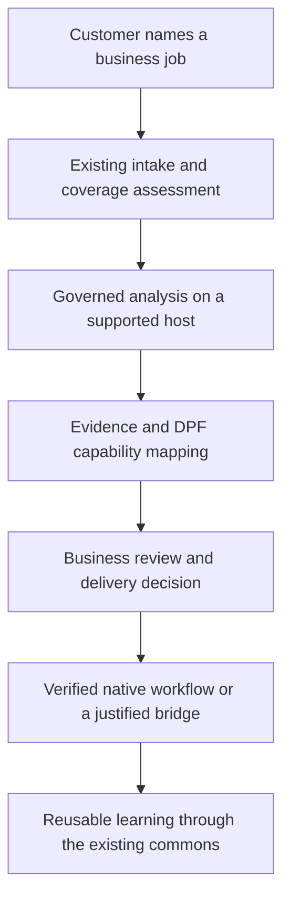

# REA absorption and hardware-neutral business AI

REA is included in DPF’s planned absorption direction. Selected analysis capabilities should be absorbed into the platform so AI coworkers can understand a customer’s existing software, map useful behavior onto DPF’s business model, and help the organization own its data and operating choices. DPF owns the interpretation, simplified workflow, authority, and verified implementation.

The first investment should connect existing DPF intake, coverage assessment, governed tools, and delivery evidence. Start with static analysis of a controlled JavaScript fixture. Add browser observation and native analysis only when a customer job justifies their host and execution requirements.

Research date: October 11, 2026. Founder direction approves including REA through absorption and sets the allocation at **80 percent refactoring and integration, 20 percent net new capability**. Delivery still requires live DPF reconciliation and governed implementation. The configured MCP endpoint timed out; install purpose, current grants, live records, and runtime readiness remain unverified. This source record preserves the research and proposed delivery slices. Associated corpus changes extend existing guidance; no install changes, tool installation, database writes, or runtime qualification were performed.

## Verified upstream project

The upstream is [morluto/rea](https://github.com/morluto/rea). The npm package is `rea-agents`. Registry metadata returned release **6.4.0**, with release commit `a56f7bb668ab23fec8d33f7af353ac7ed2fe1895`. The researched main revision was `23d50ea3bec186b4459d36c04854a92276accdf1`; its package also declares 6.4.0. Equal version strings do not establish equal code. Pin release bytes and test the capabilities actually packaged. [Release boundary](https://github.com/morluto/rea/blob/23d50ea3bec186b4459d36c04854a92276accdf1/docs/installation.md#released-package-and-main).

REA’s code is MIT licensed and allows incorporation with its notice retained. That notice concerns REA’s own code; analysis engines and target applications need their own provenance and permission assessment. [REA license](https://github.com/morluto/rea/blob/23d50ea3bec186b4459d36c04854a92276accdf1/LICENSE).

REA documents local analysis of native binaries, JavaScript/Electron, .NET, websites, network captures, Android, firmware, and other artifacts. Native work can depend on external engines; static JavaScript inspection needs no native decompiler. “Anything” is a project name, not evidence of universal coverage. Analysis is local, but results delivered to a model follow that model provider’s data policy. [Project capabilities](https://github.com/morluto/rea/blob/23d50ea3bec186b4459d36c04854a92276accdf1/README.md).

Upstream MCP discovery lists tools even when they are unavailable. Actual availability must come from the live session for the selected target, provider, and host. Evidence has identities and normalized results; retained references belong to a session and must be exported before session closure when needed later. REA does not itself enforce DPF’s coworker grants. [MCP contracts](https://github.com/morluto/rea/blob/23d50ea3bec186b4459d36c04854a92276accdf1/docs/mcp-contracts.md).

Windows Ghidra support is experimental and bounded to specified Windows x64, local NTFS, JDK/Ghidra, and PE target conditions. It is not a basis for promising arbitrary Windows analysis. [Windows boundary](https://github.com/morluto/rea/blob/23d50ea3bec186b4459d36c04854a92276accdf1/docs/windows-ghidra-p0.md).

## How DPF arrived here

Initial research inspected DPF revision `fac030aac5bae774d3d9aa0a2aefd106a4e810c8`; this source preservation branch starts at `9f95f3c9b7a`. The following dates describe recorded design and Git history, rather than the down install’s current delivery status.

| Recorded point | Direction | What REA could contribute |
| --- | --- | --- |
| July 23 incumbent application coverage design | Learn what the customer already runs; join it to existing identity and portfolio models; assess coverage and route genuine gaps to backlog. | Evidence about the customer’s actual feature, rather than a vendor-level assumption. |
| August 1 coverage commits, PRs 3894 and 3906 | Add the assessment model and matching stages, preserving proposed versus confirmed provenance. | Better inputs to the evidence field and AI proposal stage. |
| August 3 complexity shield patterns, PR 3952 | Shape workflows by role and company size; use business language and short operator paths. | Recover useful behavior while designing a simpler DPF interaction. |
| August 16 market aperture, PR 4378 | Expand existing scouting into cited challenges to DPF designs. | Investigate a selected challenge after triage establishes a reason to proceed. |
| September 23 absorption commandment, PR 5562 | Own and blend capabilities into DPF while shrinking dependencies. | Absorb selected implementation and evidence patterns; avoid a permanent adjacent REA stack. |

The relevant historical anchors are `2026-07-23-incumbent-application-coverage-design.md`, `2026-08-01-incumbent-coverage-assessment.md`, `complexity-shield-role-patterns.md`, `2026-08-16-hive-scout-market-aperture-design.md`, and `absorb-dont-adopt.md`.

This trajectory already answers the expansion question: discover demand, investigate the job, identify shared behavior, simplify its interaction, deliver against canonical entities, and learn across installs. REA supplies an investigation capability within that trajectory.

## Existing architecture to extend

Source inspection establishes useful starting points:

| Existing DPF owner | Proposed extension |
| --- | --- |
| `DigitalProduct`, `CatalogIdentity`, incumbent intake | Bind each investigation to the existing application identity, version, customer scope, and named business job. |
| `IncumbentCoverageAssessment` | Attach feature-specific evidence and limitations to the existing proposed verdict. Preserve confirmed assessments. |
| `McpServer`, `McpServerTool`, discovered tool governance | Admit a bounded set of analysis operations through existing approval, effect, grant, and schema-digest policy. |
| `RawSource`, knowledge and execution evidence | Preserve source locators and provenance; select the existing artifact owner for large bundles after a live audit. |
| Governed executor, queue and workrooms | Run analysis independently of the browser page and record execution, failures, cancellation, and evidence. |
| Portfolio and authorized surface projection | Explain the result in the customer’s existing business context, using the same read model for human and coworker access. |
| Existing scouting and gap intake | Route new capabilities through dedupe and triage, then the governed delivery process. |

A concrete improvement is available in `apps/web/lib/incumbent/coverage-ai.ts`: the current proposer input contains **name and vendor**, and produces a verdict and reason. Add verified business-job observations through that existing inference seam. Do not invent confidence gains or treat an analysis result as proof of DPF coverage.

The schema already quarantines newly discovered or materially changed MCP tools. Approved tool identity, content digest, grant, effect, and execution mode are DPF-owned. REA discovery and annotations must not override those controls.

Host-local execution remains an architectural question. Existing `EdgeNodeCapability` records describe capability authority and health; their presence does not prove an arbitrary analysis executor exists. Inspect the existing Edge and worker execution contracts before choosing transport or proposing a new capability identifier.

## Proposed investigation and absorption flow

Use public documentation, supported APIs, exports, and customer-supplied source before deeper inspection. REA is useful when those inputs leave a specific question unanswered.

Each proposed analysis request should identify the business job, existing application record, authorized target, target digest/version, selected operation, permitted effects, allowed data flow, host requirements, resource bounds, and retention needs. Reuse existing request and evidence contracts wherever they can carry this information.

The result should separate observed facts, inferred behavior, unobserved cases, and the proposed DPF mapping. Keep the relationship between claims and evidence explicit. Screens, strings, and traces can suggest behavior; they do not establish complete semantics.

For example, understanding a scheduling feature must lead to a DPF requirement such as “prevent overlapping appointments for the same worker,” with tests for boundary times and exceptions. It must not silently import the incumbent’s database layout or administration hierarchy.

REA’s application workflows trace features through application graphs. Its reconstruction guidance emphasizes evidence and remaining obligations. Those are useful patterns for deriving tests and recording what remains unknown. [Application workflows](https://github.com/morluto/rea/blob/23d50ea3bec186b4459d36c04854a92276accdf1/docs/javascript-application-workflows.md), [Reconstruction readiness](https://github.com/morluto/rea/blob/23d50ea3bec186b4459d36c04854a92276accdf1/docs/reconstruction-readiness.md).

## Business interaction and UI design

An owner should be able to say: **“We enter the same booking twice. Can you help us stop?”** The coworker identifies the relevant job and tools, proposes the narrow investigation, and returns a business recommendation.

Use the existing workroom or portfolio detail surface. The primary view should show the job, the finding, the recommended next step, remaining uncertainty, and the consequence of proceeding. Put provider details, decompiler output, graph navigation, and raw evidence behind a detail disclosure.

A proposed operator path is four interactions: describe the job; confirm the relevant tool and data scope when needed; review the comparison; choose a concrete next action. Actions could be “Try with sample bookings,” “Keep this connection,” or “Plan the change.” Ask for a consequential decision when a concrete result exists.

Show readiness in plain terms: “Can inspect this export,” “Needs a supported analysis host,” or “This version has not been checked.” Keep “DPF can do this,” “DPF can connect to this,” and “This needs work” distinct. A discovered capability must never appear as shipped product coverage.

Apply the existing theme and authorized surface contracts: keyboard access, readable contrast in both themes, meaningful focus states, text labels alongside status color, mobile reflow, and shared human/coworker action permissions. Progress must survive navigation and reconnect from durable state.

Browser capture needs separate effect classification from static inspection: navigation, interaction, and network observation can contact live systems. Use controlled fixtures before customer workflows. [Browser observation](https://github.com/morluto/rea/blob/23d50ea3bec186b4459d36c04854a92276accdf1/docs/browser-observation.md).

## Phased delivery proposal

These are proposed slices for matching to existing backlog after recovery. They are not filed items, approved scope, or passing gate receipts.

| Slice | Deliverable | Acceptance before expansion |
| --- | --- | --- |
| 0 Recover coordination | Verify live install purpose and authority; retrieve WWMD absorption decisions; inspect overlapping backlog and current source readiness. | Reuse or update existing scope, establish live coverage, and record a governed decision for the selected integration shape. |
| 1 Prove a narrow analysis capability | Use a controlled, permissively licensed JavaScript fixture with known behavior and an intentionally unobservable case. Evaluate pinned REA release bytes in a governed test environment. | Preserve target/version identity; recover the known behavior with citations; report the unknown case; prove scoped execution and cleanup; show that analysis and inference remain within the chosen data boundary, including failure paths. |
| 2 Connect evidence to coverage | Extend the existing assessment proposer and evidence projection with feature observations. | Repeated runs are idempotent; confirmed decisions survive; a claim traces to evidence; existing gaps dedupe rather than create duplicate work. |
| 3 Deliver the owner workflow | Complete one named business job through the existing surface and coworker interaction. | A nontechnical persona finishes within the existing seven-step maximum; both themes and narrow viewport work; consequential actions use governed authority; explain where data is processed without asking the owner to configure technical policies. |
| 4 Prove generalization | Validate with a second business archetype and a second supported analysis provider or provider fixture. | Swap the analysis implementation without changing business callers; reuse the same identities, assessments, and evidence projection. |
| 5 Expand by demonstrated demand | Consider browser/network observation, .NET, Android, or native analysis for specific unresolved jobs. | Each addition has measured value, supported host evidence, bounded effects, and a dependency retirement or recorded justification; restore/export and supply-chain evidence support the selected control profile. |

The recommended first production candidate is a repeated scheduling or intake job. Select it from live customer demand after recovery; the examples here are illustrative, not evidence of a current customer requirement.

Measure operator steps and time to a usable recommendation, analysis cost and duration, supported versus unsupported targets, correctness on known fixtures, evidence coverage, duplicate gap rate, and actual dependency change. Establish baselines in the pilot. Do not advertise savings from hypothetical vendor displacement.

## Refactoring allocation and dependency control

Allocate **80 percent of the work to refactoring and integration, and 20 percent to net new capability**. DPF is still proving its design and standards for trusted business AI. Spend the larger share joining and simplifying existing identity, evidence, governance, execution, inference, and product surfaces. Use the smaller share for missing behavior demonstrated by the pilot.

Use that allocation on the seams the pilot exposes:

1. Extend the existing `CoverageProposer` input and one shared evidence projection, rather than adding a competing assessor.

2. Keep provider transport and host paths outside business classification. Put small contracts in the owning inner module and preserve the application dependency direction.

3. Consolidate discovery, schema validation, effect classification, and execution evidence through existing MCP governance.

4. Keep the UI and coworker on one read model; remove duplicate result formatting introduced by the pilot.

5. Preserve behavioral characterization while consolidating; do not turn an unrelated platform cleanup into a pilot dependency.

This allocation matches the recorded absorption direction: the platform’s value comes from making its existing parts operate coherently. Each delivery slice should state which existing seams it consolidates, what new behavior it adds, and the evidence that the resulting business workflow is trustworthy.

Prefer absorbing a small, attributable portion of REA’s source when ownership and maintenance are practical. If an engine cannot be absorbed, evaluate a DPF-built pinned tool artifact that runs only when called, behind a replaceable platform contract. A temporary research adapter can establish value, but it must have an explicit exit or justification before becoming a shipped dependency.

Before accepting any new package or image, name what it retires and measure the net dependency change. Optional installation does not erase maintenance burden. Do not bundle REA’s entire setup wizard or let it rewrite customer agent configurations as a business workflow.

## Future expansion across customer ecosystems

Package each reusable capability around a business job, required inputs, evidence expectations, tested behavior, applicable archetypes, authority boundaries, supported hosts, and a simplified operator interaction. Resolve those properties through DPF’s existing skill, capability, policy, and install activation mechanisms.

A small company should not need to know whether the work used REA, a documented API, an export parser, or another future project. The coworker chooses a supported method within its authority and explains the business result.

Platform choices belong to WWMD; customer adoption and workflow priorities belong to WWWD; profession-specific standards belong to WSID. A platform analysis capability does not authorize a customer migration.

Keep customer artifacts and operational findings scoped to their organization. Contribute sanitized general requirements, reusable methods, and verified improvements through the existing Hive/commons flow. Scouting remains observation and triage; code absorption occurs in reviewed source delivery.

The expansion mechanism should be repeatable: demand leads to a bounded investigation; evidence leads to a business capability mapping; delivery proves the workflow; shared learning improves future installs. REA is the first included candidate for this mechanism. Customer control of business data, decisions, and provider choice is a design requirement throughout.

## Organizational control and trusted business AI

The product goal is an organization that can use capable AI while retaining control of its records, business rules, credentials, decision authority, and ability to continue operating. REA helps expose useful behavior in existing software and can reduce dependence on a vendor for a particular workflow. DPF must turn that understanding into tested capability and a practical exit path.

Trusted operation needs evidence beyond an impressive demonstration: role and tenant isolation, bounded actions, traceable decisions, verification against known behavior, recovery after interruption, and human review where consequences require it. A smaller local model should perform only the jobs for which it has demonstrated competence. When it cannot, the platform should explain the limit or route work within the organization’s approved policy.

The first pilot should include these control requirements:

| Control | Evidence required |
| --- | --- |
| Analysis and inference location | Target files, derived evidence, prompts, logs, embeddings, and inference follow the selected residency policy. A local-only workload fails visibly if no qualified local route is available. |
| Operator authority | The organization controls credentials, permitted actions, encryption keys where applicable, and access to business evidence. |
| Data portability and continuity | Export and restore business records, configuration, and retained evidence; demonstrate recovery without the original analysis session. |
| Supply chain and updates | Pin analysis code and engines; retain notices, provenance, and an auditable dependency inventory. Identify who can publish and approve updates. |
| Product claims | Distinguish observed behavior, inferred behavior, delivered DPF capability, and unverified gaps. |

REA’s local analysis is one part of this control chain. An external model receiving its results changes the data boundary. Cloud assistance remains a customer choice where permitted; it cannot silently replace a local-only policy.

## CADA and the existing sovereignty programme

The European Commission published the **Cloud and AI Development Act proposal on June 3, 2026**. Its proposed framework addresses EU cloud and AI capacity and sovereignty, including public-sector adoption. It is an EU proposal, not a blanket enacted requirement across EMEA. [Commission proposal](https://digital-strategy.ec.europa.eu/en/library/proposal-cloud-and-ai-development-act-cada).

The Commission describes four assurance levels, progressing from EU infrastructure location to provider independence, ownership/control, and stronger software supply-chain control. Location alone therefore does not establish the higher assurance levels. REA absorption can contribute to dependency control and evidence; it does not confer a sovereignty rating or certification. [Commission sovereignty framework](https://digital-strategy.ec.europa.eu/en/policies/cloud-and-ai-development-act).

DPF already records this work in `docs/architecture/2026-06-19-cada-cloud-sovereignty-architecture-note.md` and `docs/strategy/2026-09-us-dependency-inventory-and-sovereign-channel.md`. Those historical documents identify concerns beyond runtime inference: host dependencies, package/image distribution, model-weight sources, update control, signed SBOM evidence, and an appropriate operator/steward structure. Their current delivery state needs a live check.

Extend that programme with REA’s engines, bridges, package artifacts, and evidence flows. Keep certification and jurisdiction-specific assessment with the existing compliance and architecture owners.

## Hardware access and operating economics

DPF’s existing `docs/install/hardware.md` distinguishes provider-assisted operations, local-first operations, and contributor/development workloads. Use those existing profiles. A business running coworkers should not have to purchase a development workstation merely because deeper analysis occasionally requires one.

Benchmark the actual pilot before changing hardware guidance: model competence, memory, context size, concurrency, analysis duration, power use, backup, and support burden. Prefer static inspection when it answers the question. Schedule heavier analysis through an authorized customer-controlled worker or an approved operator deployment if the existing execution contracts support it.

Evaluate both customer-owned hardware and customer-controlled infrastructure operated by a suitable provider. Physical hardware ownership can strengthen independence; it is one deployment choice. Authority over data, keys, software, updates, and exit remains necessary in either model.

The strategic opportunity is faster, more capable local inference that makes the existing DPF business stack practical for a wider range of jobs. Prepare for that future through replaceable inference contracts and lower platform overhead, while measuring today’s local capability honestly. Improving hardware value may lower entry cost; neither a price decline nor a particular chip is a delivery dependency.

## Preparing DPF for fast capable inference

The founder’s current constraint is the speed and capability of available local inference relative to leading hosted providers. The strategic aim is to build the integrated business platform now, so increasingly capable inference can make more of its workflows practical without redesigning the platform. Current local productivity and future potential must be evaluated separately.

[ChatJimmy](https://chatjimmy.ai/) is a relevant signal. Taalas describes HC1 as a model-specialized silicon demonstrator running Llama 3.1 8B and reports **17,000 tokens per second per user** under its published test conditions. This is vendor-reported generation performance, not a measured DPF workflow result. The listed demonstrator is a **2.5 kW server**, so it does not establish that an affordable office appliance is available. [Taalas products](https://taalas.com/products/).

Taalas also acknowledges quality degradation from its first implementation’s quantization. Faster inference makes more iterations feasible; it does not establish stronger reasoning, reliable tool use, or correctness. Plans for stronger models need release and workload evidence before they become DPF assumptions. [Taalas technical description](https://taalas.com/the-path-to-ubiquitous-ai/).

For DPF, fast and sufficiently capable inference could make the coworker’s propose, inspect, test, and revise loop interactive. REA could supply observations; the model could interpret them; deterministic checks could validate proposals against canonical business rules. Additional iterations are useful when they add evidence or pass independent tests. Repeated agreement from the same model is not independent verification.

### Bottlenecks after inference becomes fast

| Remaining bottleneck | Refactoring priority |
| --- | --- |
| Context retrieval and input preparation | Fetch narrowly from canonical records; cache reusable knowledge with explicit freshness; keep large REA artifacts outside model context until needed. |
| Browser, external API, and analysis-engine waits | Use existing durable execution, reuse completed evidence, and overlap genuinely independent reads within resource and authority limits. |
| Data writes and business constraints | Preserve transactions, idempotency, conflict checks, and domain invariants; avoid making the model the system of record. |
| Coworker coordination | Remove duplicate handoffs and repeated interpretation; retain auditable ownership and bounded execution. |
| Verification and human decisions | Apply deterministic checks where available and present only material decisions to the operator with concrete evidence. |

Measure the whole business outcome: queue wait, time to first token, input/prefill time, generation, tool execution, database work, validation, and operator decision time. Use p50 and p95 latency, correctness, cost, context limits, and concurrent workload behavior. Record provider/model identity with the evidence.

The 80 percent refactoring allocation should reduce those existing overheads and keep inference replaceable. Use the 20 percent net new allocation for gaps exposed by the fast-inference pilot. Test the platform with a controlled fast provider fixture to expose its own overhead, then qualify a real provider separately for latency and competence.

Taalas documents an OpenAI-compatible chat-completions endpoint, providing a possible protocol seam for an evaluation. Compatibility alone does not establish DPF integration, structured output, tool-call behavior, suitable context capacity, or local deployment. Evaluate those properties through the existing inference routing and qualification paths. [Taalas API](https://api.taalas.com/).

This is a hardware-neutral architectural direction. A GPU, model-specialized chip, or another accelerator can serve the same business contracts if it satisfies the workload and control requirements. For specialized silicon, evaluate model refresh, supported adapters, replacement/support, and operating cost. A remote speed demonstration does not satisfy the local-only sovereignty goal; that goal needs a deployable, customer-controlled execution path.

## Continuity under ownership and jurisdiction changes

AMD announced a **definitive agreement to acquire Taalas on August 6, 2026**, subject to closing conditions and regulatory approvals. The announcement describes integration into AMD's accelerator and system roadmap. It does not establish completed acquisition, customer-owned availability, pricing, or indefinite access to the demonstrated service. [AMD announcement](https://ir.amd.com/news-events/press-releases/detail/1296/amd-acquires-taalas-to-advance-compute-solutions-for-rapidly-growing-ai-inference-market).

Treat provider acquisitions, service withdrawal, restricted exports, unavailable model updates, and divergent jurisdiction requirements as continuity scenarios. Their likelihood and impact vary by organization and workload. Do not require a prediction of political outcomes to justify replaceable contracts, export/restore, controlled updates, and qualified alternatives.

Test continuity concretely: withdraw the preferred inference endpoint; restore retained analysis evidence after session loss; replace a qualified provider without changing the business workflow; and show that a local-only job remains blocked when no permitted route exists. A cloud-assisted organization may accept a different continuity tradeoff through its owning business decision.

WWMD owns platform portability and evidence standards. WWWD owns an organization's accepted dependencies, spending, and migration priorities. WSID owns domain qualification and jurisdiction-specific interpretation. A sovereignty trend or fast silicon demonstration is evidence for evaluating options, not authority to change a customer's operating policy.

## Competitive framing

The closest verified reference to the Meta-associated agent described as “Muse” is **Manus**. Manus announced on September 1, 2026 that it had resumed independent operations; it also acknowledged that some users had needed backup/restoration and experienced interrupted access during the transition. That is a concrete continuity consideration, not proof that all hosted agents are unreliable. [Manus announcement](https://www.manus.im/blog/manus-resumes-independent-operations).

Meta separately markets its Business Agent for customer interactions and provides a platform for businesses to build agents. Those vendor descriptions are claims of capability, not independent evidence that an agent can safely run every important business process. [Meta announcement](https://about.fb.com/news/2026/06/meta-business-agent/).

DPF’s proposed distinction is measurable: the organization can see and constrain what its coworkers do, retain and restore its records, choose its execution boundary, and replace an analysis or inference provider. Prove those properties in the pilot before using them in market claims.

## Evidence and next delivery boundary

REA provenance, release metadata, license, and documented contracts were inspected. DPF source, schema, selected plans, and relevant Git history were read. REA was not installed or executed; no analysis-engine benchmark or DPF runtime test was run.

After DPF recovery, record this founder direction in the existing work and retrieve live `absorb-dont-adopt` and `data-sovereignty-follows-control` guidance and valid WWMD decisions. Reconcile the proposal with EP-ECOSYSTEM-ABSORPTION-ARCH, EP-ASSET-INTELLIGENCE, and the existing estate/dependency sovereignty programmes. Check current status before reusing historical BI identifiers.

Then record live backlog coverage for independently shippable slices, decide the analysis execution location, and implement the first fixture pilot in a governed worktree. Tests must cover grant denial, changed tool digests, unsupported providers, target containment, evidence preservation, repeated assessment, and cancellation/cleanup. UI delivery also needs served-target verification. This source record preserves research during the outage. It does not substitute for live backlog coverage, decision receipts, or execution evidence.

## October 25 operating-model reconciliation

The COO's cross-room operational follow-through is a prerequisite for independent
business operation, including the investigations and absorption work described
here. Customer demand, analysis, implementation and acceptance remain distinct
Workroom outcomes with accountable coordinators. The COO follows blocked
handoffs and verifies that recovery reaches its outcome; the founder must not
supply a recurring status/restart loop.

The [current coordination design](../superpowers/specs/2026-09-03-coordinated-workrooms-design.md#october-25-amendment-coo-operational-follow-through)
is authoritative for that operating contract. BI-4B48E7FE tracks the repair;
BI-756C899D owns truthful progress and BI-C43FD3E5 owns durable recovery supervision.
This supersedes an Advisor-only or report-only COO interpretation, without
granting authority to specialists or claiming the repair is already deployed.

Assess this strategy by verified business outcomes and human steps removed,
including recovery time, unacknowledged obligations, repeated founder nudges and
unresolved external handoffs. Available tools, running agents and completed
implementation records alone do not demonstrate independent operation.

### Harness improvement and operational ownership

The founder-supplied Harness2 and Meta-Harness references reinforce a proposed
strategy of improving the system around the model from measured execution
failures. The [coordination design](../superpowers/specs/2026-09-03-coordinated-workrooms-design.md#harness-engineering-alignment-requested-by-the-founder)
records the research and DPF's boundaries. The COO owns operational follow-through;
the existing improvement process owns tested, reviewed harness changes.
Evaluate this approach by completed business outcomes, human interventions,
recovery time and cost. An optimization benchmark or a revised COO prompt alone
does not prove independent business operation. Implementation and onboarding
verification remain pending.
