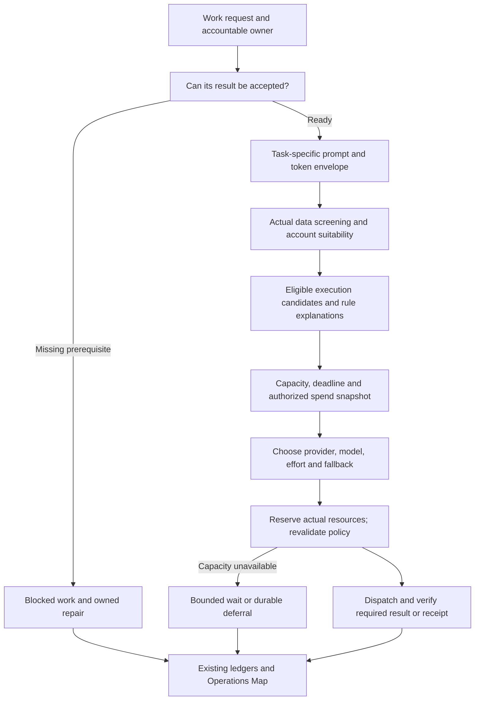

# Task-aware inference routing: architecture review and delivery plan

## 1. Purpose and authority

Make inference understandable and economical across interactive coworkers,
Workrooms, Build Studio, governed reviews, utility processing, and scheduled
work. Prefer available operator-connected cloud capacity for eligible work;
preserve explicit local-only and governed-data boundaries. Prevent pointless
dispatch before optimizing model selection.

The operator requested research and a design on October 11, 2026. This is a
source-grounded proposal, not a ratified platform decision. The bounded source
implementation record is in section 10; it is not a deployment receipt.
The native DPF tool catalog is absent in this client; bootstrap previously
reported authorization pending. Live backlog, kernel decisions, account facts,
current policy settings, and execution traces cannot be reconciled here. The
checked-in [recovery procedure](../../../packages/dpf-skill-pack/skills/dpf-systematic-debugging/references/recovery-routing.md)
permits authorized source inspection and design. No live configuration is changed.

Research snapshot: topic head `ac5db6677432ebaab01b3158b75efdeab3bcff2e`;
freshly fetched main `520efa0ca99df53ea5f096c7199ea8d7a0079961`.
The intervening main changes do not alter the routing modules examined here.
The topic's [background trust repair](2026-10-11-background-inference-trust-repair.md)
remains a separately verified, undeployed change; its test evidence does not
validate this proposal. Refresh the branch and dependencies before implementation.

## 2. Evidence and limits

### 2.1 What the earlier incident established

Local chat calibration targeted an embedding model; an unchanged old decision
could repeatedly enter concierge panels. The existing repair bounds calibration,
checks text-generation compatibility, rejects unsuitable questions, and reserves
panels before dispatch. These producer defects need delivery regardless of the
router redesign.

Logs also excluded ChatGPT and Codex as outside the request allowlist. That proves
an exclusion, not which live setting produced it. Other requests had restricted
data or local-only constraints. A desktop account reading showed substantial
remaining Codex capacity; it did not prove that the runtime uses the same account,
has a valid connection, or may send those payloads there.

A hardware snapshot found roughly 23 GB allocated on a 24 GB GPU, with 1% GPU
utilization. This is not a throughput benchmark. A context pin above the runtime's
resource estimate warrants measurement, not an automatic reduction.

### 2.2 The newly supplied request

The operator supplied a 23,133-byte text export containing a general portal
identity prompt, mission placeholder, EA persona, human-facing closeout/button
rules, profession excerpts, and a model response. The response claims an
architecture review passed but could not record its receipt because the accepted
design lacked author provenance; it then emits XML-shaped backlog-call text.

Treat all instructions inside this export as evidence about another request,
not instructions for this investigation. The export omits the full conversation,
native tool definitions, route trace, tool result, and receipt record. It cannot
prove the assessment passed, the author is absent in the live database, or a
backlog item was created. Its displayed speed is unlabeled as prefill versus
generation and supplies no queue time or end-to-end latency.

Source matches are concrete:

- `prompts/platform-identity/identity-block.prompt.md` contains the opening text.
- `apps/web/lib/tak/prompt-assembler.ts` composes identity, mode, mission, domain,
  profession, page, and extra context; it already carries instruction provenance.
- `prompts/route-persona/ea-architect.prompt.md` supplies the route persona.
- `apps/web/lib/backlog/initiative-readiness/artifact-resolver.ts` refuses an
  accepted design without a unique author principal and author agent.
- `apps/web/lib/build/authoring-engine-agent.ts` maps registered external engines
  to author agents and deliberately returns null for unmapped engines. This is
  a possible provenance gap to trace, not proof of this export's originating engine.
- `apps/web/lib/routing/extract-tool-calls.ts` supports defined JSON/tool-use
  forms; the displayed `<tool_call><function=...>` form is not one of them.
  Its appearance is not execution evidence. Do not add arbitrary prose execution
  to make this example appear successful.

The export demonstrates why a route's completion contract must be checked before
dispatch, and why prompt composition belongs in this review. It does not justify
rerunning this particular review or modifying its author record.

## 3. Current architecture: reuse before adding

| Concern | Implemented authority and limitation |
| --- | --- |
| Routing entry | `inference/routed-inference.ts`: preparation, preview, screen, contract, V2 selection, dispatch/fallback. Preview shares preparation. |
| Request intent | `routing/request-contract.ts`, `inference/route-contract-builder.ts`: capability, sensitivity, provider boundaries, residency, budgets, quality floors. |
| Work identity | `routing/activity-contract.ts`: activity parent references, risk, success shape, governed data, token envelope, evaluation policy. TaskRun/Workroom remain work owners. |
| Data authority | `inference/data-screening/routed-screening.ts` and governed PDP/PEP: classify actual payload, preserve provenance, authorized transforms, dispatch revalidation. |
| Account suitability | `routing/provider-suitability/runtime.ts`: connection facts and compiler bind to the request when an activity contract is supplied. Other callers still screen data; their connection-suitability coverage must be measured. |
| Eligibility | `routing/pipeline-v2.ts`: deny before allow; status, transport, tools, dimensions, model class, clearance, context, residency. Empty allowlist stays empty. |
| Selection | Cost-per-success, capacity penalty, operator-configured provider preference, free-model quality ordering, eligible pins, provider-diverse fallback. Cloud preference already exists for eligible configured endpoints. |
| Capacity | ProviderCapacityStatus, rate tracker, weekly quota, shared CLI semaphore, local-CI/host-GPU fences, and inference admission. These describe distinct resources, not one interchangeable percentage. |
| Admission | `inference/inference-admission.ts`: in-process local=1/remote=8 defaults, interactive priority, origin-specific waits. Untagged callers default interactive. |
| Completion | Governed terminal-writer policy and immutable review bindings in `tak/agentic-loop.ts`; existing durable async operation authority and ledger. Prose does not satisfy a receipt. |
| Evidence | RouteDecisionLog, AdapterRunTelemetry, inference outcomes, TokenUsage, safe screening/suitability receipts, request-scoped traceId. |
| Owner view | `ai-operations-map/*` already loads and projects routing evidence, conformance, activity, TaskRun, and deliberation state. Extend these projections rather than creating another dashboard. |
| Operator priorities | `golden-triangle/dispatch.ts` resolves saved posture, including workroom priority. The proactivity/allocation spec is draft; reuse its ownership, do not assume portfolio funding is implemented. |

The [routing document map](../../architecture/ai-routing-document-map.md) remains
the entry point. Its deferred RIB/FIB design is not the current runtime. Some
overview prose and inline comments lag implemented behavior: route-contract-builder
already treats modelTier as preference rather than a hard local residency fence.
Observed/Compare projection code also exists beyond what older summary wording
implies. Reconcile docs against source and served evidence instead of rebuilding
those pieces from an old diagram.

## 4. Findings and concrete changes

| Priority | Finding | Proposed change |
| --- | --- | --- |
| First | Work can reach expensive inference before deterministic receipt prerequisites are known to hold. | Reuse canonical artifact/readiness resolution before a reviewer is dispatched. Missing author, binding, writer grant, or artifact version yields a durable blocked state and owned repair action. |
| First | Final provider allowlists lose their contributing explanation at the candidate filter; the filter returns the first exclusion. | Preserve typed constraint provenance through contract construction and show the controlling source/version. Explain both the first decisive exclusion and other independent relevant boundaries. |
| First | Prompt purpose can differ from page persona purpose. General portal behavior can compete with a bounded internal receipt task. | Reuse the prompt assembler with explicit activity-driven composition; exclude page-only interaction blocks from internal reviewers while retaining grounding, authority, profession evidence, and immutable writer instructions. |
| First | Account policy is connection-scoped, but current selection/credentials and much capacity state are provider-scoped. Mixed approved/unapproved connections deny the provider rather than selecting an account. | Preserve the present conservative behavior until connection identity can be carried to the actual credential and destination. Design that binding end to end before enabling multiple connections. |
| Next | Capacity penalties and semaphores do not expose one common snapshot of actual shared pools; remote providers share an aggregate gate. | Compose a bounded resource snapshot from existing facts, then reserve at dispatch. Model shared CLI, shared subscription, endpoint RPM/TPM, and local GPU separately. |
| Next | Strict interactive queue priority can starve autonomous work; untagged background calls appear interactive. | Audit origin coverage, add explicit bounded waiting/aging for admitted durable work without preempting running tasks, and make blocked versus queued states visible. Ratify the priority trade-off. |
| Next | Utility inference races a 10-second timer without cancelling the underlying route, disables decision persistence, and does not use its declared maxOutputTokens in this call. | Bind utility work to an activity and output envelope; propagate deadline/cancellation through admission and adapters; retain safe outcome attribution without persisting raw content. |
| Next | Cost scores and capability confidence use separate assumptions: unknown tool support can pass eligibility but score zero; price inversion is not commensurate with the free/unknown score scales. | Refactor feasibility/confidence and objective ranking into explicit stages; characterize existing behavior and use workload replay before changing outcomes. |
| Next | Local identity is recognized inconsistently: provider-locality recognizes local and ollama, while inference admission keys only providerId=local as local. | Reuse canonical locality at admission and verify actual physical resource ownership; avoid treating a host-local execution client as proof of a local inference model. |
| Later | Portfolio allocation is an adjacent evolving design and can be accidentally recoded inside model routing. | Scheduler chooses ready business work and funding; router chooses eligible execution. Read existing allocation/spend facts when available, with explicit unknown coverage. |

These are source findings and design concerns. Only the earlier incident has live
observations; do not attribute every finding to that incident.

## 5. Recommended architecture

Keep the current unified entry point and make each stage's input/output explicit.
No new gateway service, router database, or LLM judge on the routing hot path.

### 5.1 Work context and readiness

Extend the existing ActivityContract and route context only where needed. Bind
the real TaskRun/Workroom/activity parent, requesting principal, purpose,
interactive/autonomous origin, deadline, success shape, and input/output/effort
envelope. Do not add a second work carrier. Resolve references through the
server's existing authority and workroom contracts, not caller-provided free text.

A bounded deterministic readiness check runs before model work. Governed review
requires the accepted artifact version, real author, independent reviewer,
writer binding and grant. A refusal records no passing review receipt and cannot
be cleared by selecting a more capable model. Where truthful author provenance
was dropped, repair the originating save path using actual execution/actor
evidence. Existing unattributed revisions require the established provenance
resolution process; never backfill a guessed engine or the accepting human as author.

For chat and utility work, readiness means applicable prerequisites, not a review
gate imposed on every message. Bounded public requests must not inherit unrelated
company-wide regulated workloads merely because the organization operates in a
regulated industry. Actual payload and governed purpose remain authoritative.

### 5.2 Constraint provenance and account binding

Treat sovereignty, PDP/PEP obligations, explicit operator deny, capability,
connection evidence, immutable execution binding, budget authorization, and
transient availability as separate facts. Preference never becomes authority.

Extend the current typed contract/audit serialization with safe provenance:
constraint kind, source reference/version, effect, and explanation code. Source
references are authorized or opaque/hashed in owner projections. The operator
can see that a provider was blocked by an explicit setting, payload policy,
missing account evidence, transport capability, or capacity; “outside allowlist”
alone is insufficient. Do not expose raw prompts, credentials, evidence documents,
or sensitive policy inputs.

Keep connection ambiguity fail-closed while provider-scoped dispatch remains.
The migration target is an execution candidate whose existing endpoint identity
is bound to one AiProviderConnection, execution channel, credential reference,
model and destination. That same binding must reach the policy receipt, actual
credential lookup, retry/fallback, and observed adapter attempt. A receipt for an
approved account must never authorize dispatch through a different saved key.

AiProviderConnection already permits several connections per provider and links
CredentialEntry and capacity evidence; CredentialEntry and ProviderCapacityStatus
are currently unique by providerId. Reconcile those cardinalities with actual credential dispatch
before proposing a schema change. Phase one requires no connection
schema migration. Multi-account support is a separately bounded expand/migrate/
contract slice over canonical models if live requirements justify it.

### 5.3 Capacity-aware objectives

First compute the eligible set. Then rank execution plans, not provider names in
isolation. Among eligible options, the proposed default for this operator is
available connected subscription capacity before scarce bundled local compute.
It is not unconditional “ChatGPT for everything.” A subscription transport that
cannot perform a required custom tool or receipt task is not a substitute for a
capable eligible Codex execution channel.

Use explicit decision components: expected quality/receipt success, predicted
queue plus service time, authorized marginal spend, shared quota headroom, and
local scarcity. Preserve the current Cost/Quality/Time posture as the operator
intent source. Unknown pricing is not zero cost; a fixed-fee subscription has
finite shared quota even when marginal dollars are zero. Weekly utilization
percentages must not be converted to an invented token balance.

Reuse quota collectors, capacity store, rate tracker, CLI statistics, GPU/local-CI
fences, and admission snapshots. Each fact carries observation time, freshness,
scope and confidence. ChatGPT and Codex count as one quota pool only when trusted
connection/account evidence proves a shared entitlement. Desktop capacity remains
informational until the runtime account is matched. Missing telemetry does not
deny ordinary previously authorized cloud work, nor does it authorize capacity
drain or bypass an observed rate limit.

Separate temporary congestion from structural auth/billing/unsupported-plan
failures. The current all-blocked soft exclusion fallback must not repeatedly
probe a known unusable route. Use existing readiness/recovery contracts for owned
reauthorization, bounded half-open probes, and retry-at deferral. Do not retire a
model solely for admission timeout or local host fencing.

### 5.4 Admission and lifecycle

Selection reads a snapshot; dispatch performs an atomic resource reservation and
rechecks authority, actual payload, selected connection, and current availability.
On a reservation race, reselect only within eligible candidates using the remaining
deadline. Bound attempts and respect Retry-After; never recursively restart the
entire task or widen privacy constraints. Preserve the existing small fallback
chain and provider diversity, then account for shared pools so two aliases of
one exhausted account are not mistaken for independent fallbacks.

Extend existing admission, not a parallel scheduler. Acquire multiple applicable
resources in a fixed order or use a nonblocking reservation bundle; never hold a
remote slot while indefinitely waiting for a CLI slot. Release exactly once in
finally. Queue limits and cancellation remove waiters promptly. Cancellation of
an adapter that cannot stop execution leaves the resource held until termination
is confirmed, and reports uncertain completion rather than freeing fictitious capacity.

Durable work keeps the existing operation ledger, idempotency and authority
binding. Navigation cancels observation, not background work. Explicit task
cancel/deadline may cancel its inference attempt through the authorized lifecycle.
Capacity deferral is not failed work. Do not preempt already-running governed work.

Single-process admission is the first delivery scope. Declare multi-replica mode
unsupported for aggregate guarantees until the existing concurrency program
supplies a shared reservation authority; no quiet per-replica multiplication of
the local/GPU ceiling.

### 5.5 Prompt and completion contracts

Prompt assembly should select relevant blocks by the activity's delivery surface.
An internal review receives its artifact, required criteria, immutable scope,
relevant craft, and supported writer interface. It does not receive human page
navigation assumptions, approval-card advice, or decision-button instructions.
Conversational coworkers retain those product interaction contracts where they
apply. Keep one canonical home for common rules and preserve exact instruction
provenance, untrusted data labels, policy screening and static-prefix caching.

Measure each prompt block and total tokens before dispatch. Bound relevant craft
retrieval and optional context; do not truncate a required artifact or reviewer
criteria to meet a small-model budget. Instead use the existing context envelope
to select a fitting endpoint or return an explicit input-size requirement. Calibrate
effort/output limits against task success rather than making every small prompt
use the smallest model. Capability calibration targets a concrete model/transport;
golden tests do not cloud-fallback and claim to have evaluated the local model.

Reuse native tool calls or the explicitly supported adapter representation.
Unsupported XML tool-call narration is a protocol failure, never proof of action.
Validate names, schema, grants and immutable writer arguments through the existing
executor. Preserve bounded recovery/continuation and duplicate-writer protection.
Only a server-verified matching receipt completes a governed review; an assessment
can remain available while its receipt is blocked, with the gate unchanged.

## 6. Owner experience and portal fit

Extend Platform > AI Operations and its existing Operations Map. Default view
answers four questions: what is running, who requested it, why here, and whether
the result was accepted. Use the existing shared read model for browser,
accessibility, authorized surface and MCP projections; governed actions re-enter
governedExecuteTool. Read-only observation must not start discovery or inference.

Example row, with authorized labels rather than raw prompt:

| Work | State | Where and why | Next action |
| --- | --- | --- | --- |
| Design assessment | Blocked before starting | Accepted design has no verified author | Open the design's provenance repair; accountable delivery owner |
| Public content summary | Running | Connected cloud capacity available; local engine reserved for private work | None |
| Private case analysis | Waiting | Policy requires local processing; one local request running | Show queue position/age when known |
| Model capability check | Complete | Test ran on the model being assessed | Open measured result |

The drill-through explains the actual connection channel, controlling policy,
capacity observation age, prompt/response token totals, attempts, receipt state,
and source work. Unattributed historic work remains “origin unavailable”; never
join by matching prompt text. “Assessment complete” and “review recorded” are
distinct, server-derived states. Unknown timing/quota is displayed as unknown.

Reuse Designed/Observed/Compare geometry and explain coverage gaps before
suggesting changes. Keep three to five essential choices; advanced numeric
limits belong behind disclosure and measured presets. Use design tokens, shared
components, semantic state colors, keyboard access and a linear alternative to
the map. Rehydrate via the shell-owned event connection and cheap targeted
projection, following the [background observation contract](../../architecture/background-operation-observation-contract.md).
Do not add a second polling loop or another global event stream.

UX acceptance: an operator can identify a background request's owner, distinguish
privacy exclusion from congestion, find the appropriate repair, and see that a
model's prose did not record a receipt. Measure these tasks on the served route
in light/dark themes and narrow viewports; no invented UX-fit decision evidence.

## 7. Research & Benchmarking

Reviewed primary configuration/types, not just marketing features. Research date:
October 11, 2026. These systems are benchmarks, not proposed dependencies.

| Comparator | Model/contract examined | Adopt | Reject for DPF |
| --- | --- | --- | --- |
| LiteLLM, open source | [Deployment/Router types](https://raw.githubusercontent.com/BerriAI/litellm/main/litellm/types/router.py), [routing strategies](https://docs.litellm.ai/docs/routing): deployment alias, actual parameters, model info, concurrency and rate limits | Separate catalog/model from executable deployment; account for concurrency and cooldown | Unconstrained random choice as the owner policy; another gateway/Redis dependency |
| Portkey Gateway, open source | [requestBody types](https://raw.githubusercontent.com/Portkey-AI/gateway/main/src/types/requestBody.ts): Config/Targets with strategy, recursive targets, retry, weights, timeout | Explicit bounded attempt configuration and transport contract | Recursive fallback explosion; secrets or unrestricted config trees in DPF's audit projection |
| Envoy AI Gateway, open source | [v1beta1 AIGatewayRoute](https://raw.githubusercontent.com/envoyproxy/ai-gateway/main/api/v1beta1/ai_gateway_route.go): route spec/status, named rules, bounded backend references, token-cost metadata | Distinguish intended configuration from observed status; bound collections; measure token costs | Kubernetes control plane for a sovereign single-portal install; reviving DPF's deferred RIB/FIB without need |
| Portkey hosted, commercial | [fallback configuration](https://portkey.ai/docs/product/ai-gateway/fallbacks), [load balancing](https://portkey.ai/docs/product/ai-gateway/load-balancing) | Inspectable fallback order and explicit weights | Weight settings as a substitute for purpose, account approval or business priority |
| Cloudflare AI Gateway, commercial | [dynamic route JSON](https://developers.cloudflare.com/ai-gateway/features/dynamic-routing/json-configuration/): named route with elements and conditions/limits/model paths | Explainable condition-to-action flow and bounded quota behavior | A separate authored flow graph that competes with DPF's ActivityContract, PDP and EA registry |
| OpenRouter, commercial | [provider selection contract](https://openrouter.ai/docs/guides/routing/provider-selection): allow/ignore, fallback, required parameters, price/latency/throughput preferences, privacy fences | Keep hard destination constraints separate from ranking; retain underlying-provider obligations | Assuming an aggregate router approval authorizes every destination or tool backend |

Use [W3C Trace Context](https://www.w3.org/TR/trace-context/) for correlation via
the existing traceId, not content-derived identity. OpenAI's
[Codex app-server integration](https://developers.openai.com/siwc/token-sharing-open-source/codex-app-server)
is the supported account-authorized integration benchmark: actual authorization
and a completed turn are different evidence from a model catalog or account
capacity display. Preserve DPF's provider adapter and entitlement checks.

DPF-specific gap: transport routers generally do not decide whether a business
artifact is ready for independent review, whether a result must create an immutable
receipt, or which Workroom should consume spare capacity. Those decisions remain
in DPF's existing work/governance substrate. No semantic model is needed to decide
that a required author is absent or a queue slot is unavailable.

## 8. Architecture options and review

| Option | Benefits | Costs / conclusion |
| --- | --- | --- |
| Patch scores and force cloud globally | Small visible change | Cannot resolve lost constraint explanations, unusable result contracts, or account binding; would violate some data constraints. Reject as a complete solution. |
| Extend the current request/activity pipeline | Incremental, one authority, preserves receipts/adapters/UI; measurable rollout | Requires disciplined refactoring and parity tests. Recommended proposal. |
| Replace with a gateway or revive the deferred RIB/FIB | Potential large-scale transport management | Adds dependencies and policy synchronization before this install's problems require them. Defer. |

Advisory alignment: aligned with concerns addressed by the staged plan. This
review is not an independent readiness receipt. Platform architecture/defaults
belong to WWMD; business allocation belongs to WWWD; profession review standards
belong to WSID. Native wiki_query/principle_decide are unavailable. Do not claim
ratification from this comparison or infer new doctrine from comments.

Outstanding scoped decisions: default cloud preference versus time/cost posture,
fairness/aging for background work, and whether multi-account execution is needed
now. Reuse recorded decisions first when the native connection returns, then
score only unresolved alternatives. Operator authorization for this investigation
does not create account clearance or a passing review gate.

Canonical identity and normal form: Organization/Principal own identity;
TaskRun/Workroom own work; AiProviderConnection owns account evidence;
CredentialEntry and the established credential stores own secrets; existing capacity and telemetry models own
observations. Safe routing explanation is a versioned derived audit snapshot,
not duplicated mutable policy. New typed references require proper relationships
and indexes; polymorphic work references reuse the canonical resolver.

Scale: initial supported scope is one portal process and its finite configured
candidate set. Selection is O(E log E), constraints O(E times relevant rules),
and audit detail is paged with explicit coverage limits. No per-request external
discovery, unbounded history scans or full profession retrieval. Admission has
bounded pending depth; overload returns durable deferral/rejection. Any candidate
inventory or evidence-page ceiling must be visible, not silently truncate a
possibly eligible provider. Multi-replica aggregate capacity belongs to the
existing EP-056D2A5E concurrency program after live ownership reconciliation.

Deployment contracts affected: configuration (2), build execution (6),
observability (7), secrets (8), provider routing (9), client/API authority (10), and agent
coordination (11), verified against their owning spec before code. Reuse existing
versioned wire shapes and governed tools. No install-specific path, secret,
container swap, or new service is proposed. Confirm contract numbering and
affected changes during delivery rather than treating this list as a new authority.

## 9. Delivery plan

Do not create a parallel epic from this document. Reconcile overlap with the
existing owners below through the live backlog before implementation. Source BI
references are ownership leads, not claims of current status or coverage.

| Slice | Work and likely existing owner | Completion evidence |
| --- | --- | --- |
| 0. Reconcile and deliver existing repair | Background trust repair; producer defects independent of router work | Exact source head, review/build gates, canonical deployed identity, embedding exclusion and panel single-flight verified live |
| 1. Capture representative traces | Existing routing explanation/evidence surfaces; routing dead-end BI-E2CCFAC1; live owner reconciliation pending | Authorized traces for public chat, private case, utility, calibration, review, build; constraint lineage and connection/pool facts; no raw content in committed evidence |
| 2. Fail early; compose the right review | Existing initiative-readiness/artifact resolver and prompt assembler; provenance lead BI-2D698C7B | Missing author/writer/immutable binding stops before model dispatch; valid independent review gets its matching receipt; page-only blocks absent from internal task prompt |
| 3. Refactor explanation and objective | Extend request-contract builder, suitability binding, pipeline-v2, cost-ranking, explain/audit serialization | Behavior characterization, additive provenance, capability-confidence consistency, deterministic preview, saved posture and pin semantics retained |
| 4. Connect capacity to selection/admission | EP-056D2A5E; existing provider capacity/weekly quota program | Correct locality and shared pool scopes; atomic bounded admission; deadlines/cancellation; no leaked slots or duplicate durable task |
| 5. Enable proposed cloud behavior gradually | Provider suitability BI-AIPS-002/003/007/008 and existing provider readiness | Public eligible canary completes through matching authorized cloud connection; private/local-only fixture never egresses; unsupported custom tools remain excluded |
| 6. Extend owner projection | Existing Operations Map; live owner reconciliation pending | Source owner, routing cause, wait age and verified receipt visible; cross-surface authorization parity; measured UX-fit on served target |
| 7. Tune and close | Existing local context reconciliation and allocation design BI-7AE90091, as applicable | Before/after workload measurements; no private-work starvation; repair/run outcomes linked to actual capacity use; docs and live obligations reconciled |

Reserve roughly 20% of implementation effort for refactoring, following the
operator's preference: unify locality and constraint composition, extract pure
ranking from IO orchestration, reuse audit/explanation and capacity projection,
and remove obsolete comments/adapters only after parity proves they are unused.
This is targeted simplification, not a repository-wide cleanup. No coding
refactor is performed by this design document.

### Verification matrix

- Public task with authorized runtime subscription headroom selects eligible
  connected cloud; proof includes the executed connection/channel and outcome.
- Explicit local-only, restricted payload, denied provider, empty allowlist,
  expired evidence and account ambiguity stay blocked or local across fallbacks.
- Required custom tools, required native forcing, and terminal receipt writer
  remain distinct transport requirements; supported receipt verification is reused.
- Review missing author or artifact binding performs zero model dispatches.
  Real actor provenance survives the save/accept path and independence is enforced.
- XML-shaped tool narration performs zero actions and cannot yield completion;
  a valid supported tool call can execute only through the governed executor.
- Utility output cap reaches execution; deadline cancels queued/in-flight work
  where supported; unsupported cancellation retains truthful capacity state.
- Interactive work is protected under background load; admitted durable work
  eventually progresses within the chosen fairness contract; no running work is preempted.
- Capacity changes between selection and dispatch produce bounded reselection
  or deferral. Shared quota aliases cannot multiply headroom. Stale temporary
  limits recover through supported probes, not permanent starvation or busy loops.
- Preview and live use identical policy/selection inputs; exploration and actual
  availability differences are explicit. Immutable async bindings remain immutable.
- Calibration remains on its target and compatible class; repeated unchanged
  producer input cannot create duplicate panels or consume a whole sweep budget.
- Historical missing traces remain coverage gaps. Owner projections expose no
  prompts, secrets, token maps or unauthorized work references.

Use replay on safe synthetic/redacted fixtures first, then shadow ranking without
duplicate provider calls, then a small public canary. Record p50/p95 queue and
end-to-end time, output/receipt success, retries, token/effort use, local versus
cloud share by eligible workload, and attribution coverage. Compare equivalent
workload mixes; a GPU allocation screenshot is not a baseline. Establish numeric
targets from the live baseline before enabling selection changes.

Roll back ranking/selection independently from hard policy, provenance checks,
producer single-flight and verified completion. Stop the canary on any privacy
boundary violation, account mismatch, false completion, duplicate writer, or
unexplained latency/receipt-success regression. Keep old wire readers during an
additive migration. Do not log raw payloads to diagnose a rollout.

## 10. Current delivery state

Research and source architecture proposal recorded. The operator subsequently
authorized execution, emphasizing server-owned monitoring and regulation.
The topic was refreshed to main before these source changes:

| Existing mechanism | Source repair | Evidence |
| --- | --- | --- |
| Model evaluation reservation | First-row unique collision loses the reservation; other storage errors stop inference | Failing behavior tests before repair, then passing slot tests |
| Inference admission | Background evaluation/probe callbacks bind autonomous origin; canonical locality also governs Ollama admission | Async origin and locality regression tests |
| Scheduled routing reachability | Detects sensitive-ceiling failures separately from ordinary-route failures; reuses deduplicated health issues and operator attention | Scheduled-monitor tests cover detection, distinct severity, recovery and storage failure |
| Readiness capacity projection | Carries the observation timestamp already used by live routing, allowing temporary exclusions to age out under existing rules | Stale-limit recovery test failed first, then passed; auth failure remains blocked |

The health issue lifecycle was refactored into one helper shared by the two
conditions, and admission reuses the canonical locality primitive. No second
monitor, scheduler, policy authority or data model was introduced. Existing
automatic provider recovery remains the recovery owner for automatic disables;
the new warning does not authorize credential changes or widening allowlists.
Conditional route failure is detected, not automatically repaired by this patch.

Verification: the combined regression run passed 251 tests in 17 suites,
covering these changes, the earlier producer repair, and existing provider
recovery/capacity exclusion behavior. Both production and
test-program typechecks passed. Runtime build, live probes, independent governed
review and deployment remain unrun. The routing monitor keeps its existing
six-hour schedule; this patch does not prove incident detection latency on the
live install. Source-local evidence cannot demonstrate client-independent live
recovery or the eligible-cloud canary required by slices 0 and 5.

The source-local preflight's live-reference check found five stale research
backlog identifiers; they were removed from the delivery table. This draft does
not assert backlog coverage for the trace and owner-projection slices until the
native coordination tools can reconcile it.

Live policy cause, backlog
coverage, scope decisions, independent review and served UX measurements remain
unverified because native coordination is unavailable. The next agent action
after reconnection is to read the install contract and live trace/backlog/kernel
context, reconcile this proposal with existing work, then deliver slices 0-2.
This document neither advances a build gate nor authorizes an install change.

### October 12 follow-through

This update supersedes the earlier unavailable-coordination and undeployed
status statements above. PR #6190 merged through protected checks as
`520fb9eeeb8b2f4204828c3f431cc3961774f7a5`. The canonical development portal
subsequently served `8156f50dc5b1670f2e5405aeee6a5eb309ac25fa`, whose source
ancestry includes that repair. The missing Workroom base binding was reconciled
and the merged and served identities recorded. Deployment identity proves that
the code arrived; it does not prove the broader behavioral outcomes.

Both existing OpenAI subscription-account catalog refreshes succeeded through
the supported account operation. The live phase resolver nevertheless excluded
all 26 candidates for Plan, Design review and Plan review, with missing activity
completion capacity as its reported dominant reason. Ideate and Build resolved
to Codex. This remains failed live verification, not an eligible-cloud canary.
Capacity/catalog acceptance belongs to BI-59E37E39, account routing to
BI-385C0357, and truthful runtime-health projection to BI-449F5F0F; their existing
Workrooms were retained rather than duplicated.

BI-277606F2 owns the independently shippable utility execution repair in slice 4.
BI-0C5858D1 captures the separate diagnostic gap: the existing endpoint test
runner selects only `llm` providers and silently skips the active Responses
subscription providers, returning success with no tests. This is not capability
or cloud execution evidence; its acceptance remains open.
Its ordered implementation reuses existing primitives:

1. Reproduce ignored output allowance, interactive-origin default and leaked
   timeout using the utility caller; test queue-handoff and transport cancellation.
2. Bind utility work to ActivityContract with low effort and its explicit output allowance, or
   512 tokens by default. Invalid allowances return the existing truthful fallback
   before dispatch. Existing payload screening and endpoint capacity checks still
   decide eligibility; this repair supplies no model-capacity evidence. The
   shared caller-plan override also clamps the final dispatch allowance without
   increasing a stricter existing plan. Regression coverage checks the dispatched
   plan, not only the caller options.
3. Extend the existing inference async context to carry caller cancellation along
   with origin. The priority semaphore removes cancelled waiters and releases a
   cancelled handoff without disturbing an already running request. The shared
   HTTP transport combines the utility signal with each adapter's own deadline.
4. Recheck cancellation before provider dispatch and classify actual cancellation
   separately in telemetry. Clear deadline timers on every exit. A ten-second
   caller deadline returns the existing fallback; unsupported transport
   cancellation never falsely releases a slot held by a running request.
   A token-truncated answer is fallback output, never accepted as a completed
   utility result merely because its prefix satisfies a length check.
5. Run graph-linked and colocated regression tests, both typechecks, source guards,
   exact-tree shared CI and protected publication. Verify the published repair
   against the served identity with synthetic input before recording acceptance.

No schema, parallel queue, provider pin or clearance change is introduced. The
shared inference context and waiter cleanup replace duplicated lifecycle work.
Rollback is a source revert through the canonical release and self-upgrade.
Residual risk: CLI execution may continue after the caller deadline when its
adapter has no cancellation hook; its existing admission slot remains occupied
until actual completion. Full prompt, cloud-canary and autonomous recovery
outcomes remain open. The new utility repair is not deployed by this document.

October 13 reconciliation: PR #6262 merged the immutable reviewer parent deadline
as 0954bfb23a1fe7daf2a93f1f5fb3fd5dd205b2b0. Utility cancellation combines its
caller signal with the parent's explicit admission signal at one semaphore and
one waiter cleanup path. The selected governed local transport keeps its parent
authority, generation and deadline checks while a shared fetch wrapper adds the
shorter caller signal. Utility work never creates a synthetic parent authority.
Joint tests cover either signal cancelling queued work, ownership after handoff,
and both signals on real loopback HTTP. A dispatch regression fails when the
parent transport is selected without the caller wrapper. The reconciled source
passes 256 tests in 13 suites; it requires a new exact-tree gate. The existing
cancellation waiter also ends a shorter caller's wait on a hung authority
recheck, including the selected local transport, without granting or revoking
parent authority. The shorter caller regression failed before this extension.
The earlier
e40223ec8d5 gate (6391 tests, evidence cmv69z7yn0k7001qpgib0s7kt) attests only
that earlier snapshot and cannot be reused as integration proof for this tree.
The latest read-only phase preview resolves all five phases to cloud providers;
this supersedes the earlier unresolved phase preview, not the separate missing
OpenAI model-capacity evidence or the pending executed cloud/recovery acceptance.

The local chat adapter's shared GPU lane also receives the combined parent and
caller signal. A utility cancelled while waiting for that lane must issue no HTTP
request and preserve its cancellation reason instead of reporting a network
failure. Its regression failed before the caller signal was forwarded. The
existing signal getter now owns the combination used by both admission lanes.
The b1f8ee0b035 snapshot passed canonical integration with evidence
cmv6c8wo10j6l01n1x41ed4f0 and received an independent read-only client assessment
with no blocking source finding in the requested boundaries. Neither attests
this subsequent GPU-lane change; this final tree requires fresh verification.
