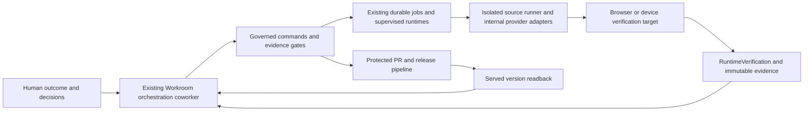

# Self-sufficient Build Studio through the orchestration coworker

## 1. Owner direction and scope

The production user describes an outcome to the Workroom's orchestration coworker.
The coworker owns research, planning, execution, verification, repair, review,
protected delivery and deployed readback. Humans see the result, evidence and
decisions that need their authority. They do not operate terminals, select
worktrees, restart provider sessions or move evidence between external clients.

The owner explicitly requested this direction on 2026-10-16, then authorized
implementation of the scoped BIs in as few PRs as practical. This supersedes the
earlier assumption that routine production users would choose an external coding
client. It does not remove provider-neutral internal adapters or make disaster
recovery depend on a broken portal. External client applications become optional
maintenance/recovery surfaces. A provider CLI supervised inside a runner is an
internal tool, not an external user interface.

This is an amendment to the [local-first delivery design](2026-09-03-local-first-agentic-delivery-throughput-design.md),
the [September T3 review](2026-09-04-t3-code-source-delta-review.md),
the [durable delegation design](2026-10-07-durable-delegation-ledger-design.md),
and [autonomous Build Studio](2026-07-25-governed-playbook-experimentation-autonomous-build-studio-design.md).
Those documents continue to own their contracts. This document owns their
integration into a self-sufficient production experience and the new device seam.

**Delivery scope:** reliable observation, coworker-led internal runtime control,
durable continuation, desktop and phone Workroom parity, contextual preview and
review, device-host verification, and measured retirement of external-client
requirements. A scope is complete only when its served workflow passes; a new
panel or an adapter class alone does not deliver it.

**Non-goals:** embedding T3 as a service, adding a second work ledger or agent
engine, replacing the shared gate/runtime lease, running iOS simulators in Linux,
removing emergency recovery access, or claiming all upstream features have been
copied. App-store release, paid service enrollment and public exposure retain
their existing authority boundaries.

## 2. Research & Benchmarking

### 2.1 Evidence and provenance

T3 was cloned read-only at
[`86534db4d3525a070589a234d660a3e0373a42ea`](https://github.com/pingdotgg/t3code/tree/86534db4d3525a070589a234d660a3e0373a42ea),
dated 2026-10-16. DPF was initially inspected at `c38edb55c0ddf10f6db4eab4848698e2aeed7019`;
the design worktree starts at `e05900d547cd74989e79d07d31f70cf011a41f79`.
These are source observations, not a runtime performance comparison. T3 tests were
read, not executed. No T3 runtime or dependency was installed. Product-wide claims
that one client eclipses another remain unmeasured.

T3's [MIT license](https://github.com/pingdotgg/t3code/blob/86534db4d3525a070589a234d660a3e0373a42ea/LICENSE)
permits reuse subject to its notice requirements. Any copied substantial code
must retain attribution and pass DPF's tool/dependency review. This review approves
patterns; it does not approve T3's transitive dependencies, native assets or brands.

### 2.2 T3 patterns and their DPF destination

All T3 paths below are relative to the immutable revision above. The mechanism
matters more than its terminal-oriented presentation.

| Source inspected | Useful mechanism | DPF incorporation |
| --- | --- | --- |
| `packages/client-runtime/src/connection/supervisor.ts`, `connection/registry.ts` | One connection owner, lifecycle wakeups and classified retries | Reuse DPF's system-event owner and background observer; add mobile lifecycle adapters rather than competing reconnect loops |
| `packages/client-runtime/src/state/threads.ts`, `threadDetail.ts` | Separate list state, selected detail and cache lifetimes | Cheap Workroom list projection; bounded selected timeline; cancel hidden detail reads |
| `docs/internals/performance-regressions.md`, `orchestration-v2/CommandOutputHub.ts` | Bounded history and on-demand noisy output | Keep console tails outside the durable decision feed; fetch only expanded evidence |
| `orchestration-v2/EventSink.ts`, `EffectWorker.ts` | Intent, receipt, state and effect recording | Finish and verify existing Workroom receipt/event/job contracts; no second orchestrator |
| `docs/internals/providers.md`, `ProviderSessionManager.ts` | Normalize provider behavior | Extend `lib/workroom-runtime` and existing engine selection; capability-check steering, resume and approval response |
| `packages/client-runtime/src/state/threadRequests.ts`, mobile `PendingApprovalCard.tsx` | Pending requests identify whether the original process can still answer | Workroom decision binds exact request, subject/version and current authority; stale requests offer recovery rather than an active approval |
| mobile `features/threads/composerSendPresentation.ts` | Explicit queue/steer/restart semantics | Coworker chooses the safe operation; users say what should change or stop |
| mobile `features/browser/BrowserPreviewRouteScreen.tsx` | Host-side browser appears in the same work context | Existing preview target and verification evidence become a Workroom Result surface |
| mobile `features/terminal/useTerminalLifecycle.ts` | Viewing history does not reopen execution | Diagnostic disclosure is read-only by default; no automatic terminal/session start |
| `docs/internals/composer-context-references.md` | Typed context tied to a precise file/comment/preview | Extend existing attachments/evidence with immutable source and target references; do not paste unbounded logs into prompts |
| mobile `features/agent-awareness/foregroundNotificationBehavior.ts` | Suppress alerts for the item already visible | Notify for meaningful decisions, failure and completion; deep-link to the canonical work |
| `apps/web/src/components/device/DevicePanel.tsx`, server `device/DeviceHost.ts` | Device preview belongs to the host and work context | Governed device capability on an existing runtime target, attached to a Workroom |
| server `device/DeviceHubProxy.ts`, `DeviceActions.ts` | Stream transport and typed control have distinct authority | Authenticate every proxy/control action; no generic shell-exec proxy; separate viewing from driving |
| server `device/DeviceToolchain.ts`, `DeviceMultiHost.test.ts` | Pinned helpers, process isolation and host-qualified identities | Reuse registered host/action and runner supervision; bind device to host, run and lease |
| `docs/internals/voice-input.md` | Dictation edits a draft with revision checks | Optional later enhancement to existing input; never submit a late transcript automatically |

The T3 device implementation uses `expo-device-hub` 0.15.3 and `agent-device`
0.21.25 at this revision. They are evaluation candidates, not accepted dependencies.
Its own device documentation records unauthenticated and shell-capable helper
routes, making direct exposure unsuitable. DPF must own a narrow typed boundary.
T3 also documents platform/decoder limitations: iOS simulation needs macOS/Xcode;
video support varies and Android lacks its iOS MJPEG fallback. A screenshot is not
proof that an action or workflow succeeded.

### 2.3 Other open-source comparators

| Comparator and primary source | Adopt | Reject |
| --- | --- | --- |
| [OpenHands conversation implementation](https://github.com/OpenHands/software-agent-sdk/blob/main/openhands-sdk/openhands/sdk/conversation/impl/local_conversation.py) | Persisted conversation/event state and runtime separation as a benchmark | An additional Python agent service/event store beside DPF |
| [BMAD review handoff](https://github.com/bmad-code-org/BMAD-METHOD/blob/main/skills/bmad-code-review/step-04-present.md) | Explicit review dispositions and next-work handoff; retain DPF's existing BMAD evaluation | Installing a competing workflow/skill engine or making a file checklist authoritative over receipts |

The OpenHands implementation's conversation state and EventLog are distinct from
its execution runtime. BMAD's reviewed step writes review results and selects a
handoff/interactive continuation; that is a useful process artifact, not a durable
queue. Neither supplies a reason to duplicate Workroom, TaskRun or gate authority.

### 2.4 Commercial comparators

| Comparator and primary source | Adopt | Reject |
| --- | --- | --- |
| [Replit App Testing](https://docs.replit.com/features/agent/app-testing) and [mobile creation](https://docs.replit.com/build/mobile-app) | Agent drives verification, reports results and repairs within one conversation | Treating provider self-test as independent acceptance or web testing as native-device proof |
| [Cursor Cloud Agents](https://prod.cursor.com/docs/cloud-agent) and [security](https://prod.cursor.com/docs/cloud-agent/security) | Execution environment is separate from the human interface | Requiring a hosted vendor runtime or dedicated external client for DPF production work |

These are documented capabilities, not controlled comparative measurements. They
support the direction without establishing throughput, cost or reliability gains.

## 3. Verified DPF gaps and reusable substrate

| Finding | Evidence | Consequence and required change |
| --- | --- | --- |
| Mobile send persists only the human message | `apps/web/app/api/v1/agent/message/route.ts` | Route through the existing authorized coworker dispatch and return its durable identity; no second agent loop |
| Mobile stream sends connected then closes | `apps/web/app/api/v1/agent/stream/route.ts` | Bind mobile observation to real authorized persisted work and the event plane |
| Build refresh has panel relay, direct agent stream and a 10-second timer | `components/build/BuildStudio.tsx` | Consolidate on `useBackgroundOperationObserver` and a bounded projection; retire redundant paths |
| An old detail fetch can set active build after selection changes | `BuildStudio.tsx` refresh callback | Abort/generation-check reads and bind all results to the requested Workroom; prove with delayed-response tests |
| Activity feed says Live regardless of transport/freshness | `components/build/AgentSessionFeedLive.tsx` | Derive live/stale/reconnecting/failed from real observer state |
| Activity feed accumulates and sorts every received entry | Same component, `mergeEntries` | Bounded visible window and paginated older history; preserve position |
| Initial timeline read and notification subscription start independently | `api/work-capsules/[capsuleId]/activity-stream/route.ts` | Source-level lost-notification window; prove/reproduce and close with committed cursor catch-up and rehydration |
| March mobile spec excluded Build Studio | `2026-03-19-mobile-companion-app-design.md` non-goals | This owner's later direction amends that exclusion through existing phone Workroom BI |
| Supervised runtimes already exist | `lib/workroom-runtime/{types,supervisor,runtime-tools}.ts` | Codex/Claude are internal provider tools; integrate them instead of introducing another engine |
| Custody, eligibility and recovery already exist | `lib/build/autonomous-build-*`, `autonomous-recovery-policy.ts` | Existing build specialist and Workroom coordinator own the process; no new agent persona/table |
| Runtime and verification identity already exist | `RuntimeTarget`, `RuntimeVerification`, `lib/runtime-coordination/runtime-targets.ts` | Extend their contracts for preview/device evidence after data review; no parallel DeviceJob or review ledger |

The race findings are source-level risks awaiting deterministic reproduction;
their frequency on the live install has not been measured. Current engine MCP
readback reports Claude/Codex/Grok/OpenCode binaries present, with probes dated
2026-10-13. Presence is not authenticated, end-to-end runner readiness.

## 4. Architecture and authority

### 4.1 One owner per fact

Workroom owns coordination identity, roster, narrowed authority and execution
binding. FeatureBuild owns the software lifecycle. TaskRun/job engine owns durable
attempts. Existing runtime adapters own provider sessions. RuntimeTarget owns the
observed preview/device environment; RuntimeVerification owns its evidence. The
existing PR/check/release records own delivery facts. UI state caches projections.

The [background-operation observation contract](../../architecture/background-operation-observation-contract.md)
remains binding: durable server projections are authority; events invalidate them.
T3's reducers are not a reason to make transient browser events authoritative.
Sequence-based history is for faithful timeline reads, not client-side gate decisions.

### 4.2 Production deployment shape

The production portal controls a capability-selected, leased execution environment.
Source checkout, provider credentials, Git operations and temporary tools stay
there. They never become writes to installed portal assets or customer production
tables. The runner may be local to the install or remote under existing host
contracts; failure to place work becomes a durable wait with a responsible owner.

Internal CLI execution is supervised, bounded and tied to the Workroom/run.
Credentials cannot exceed the requesting principal, current role grants, room
scope or action envelope. Logs exclude secrets and private reasoning. A model
switch cannot widen authority. Control and verification use test organizations and
role-scoped sign-in on governed nonproduction targets.

### 4.3 Coworker operations and continuation

Reuse the existing build-specialist persona and Workroom coordinator. It interprets
the request, selects the existing shape, gathers required evidence and invokes
governed operations. It selects provider/routing from admitted capability and
budget, not a raw owner terminal setting. New messages are persisted before
acknowledgement. Queue, steer and restart remain distinct internal operations;
the server resolves their legality from current state.

Closing a page never stops work. Process loss reconciles a durable attempt,
provider identity, queued input and outstanding decisions. Reuse existing queue
hold, retry caps, dead letters and cancellation cascade. Never replay a process-bound
approval into a replacement process. Lost context produces an explicit budgeted
handoff, not a claim that the original provider resumed.

### 4.4 Device and browser boundary

The orchestration coworker requests a verified device/browser target, opens the
application, runs a declared scenario, inspects the result and records evidence.
The owner opens Preview or Result and can annotate what should change. Terminal,
device identifier, SDK commands and transport settings stay in diagnostics.

Device execution uses the existing registered host/action seam and target lease.
Identity includes host, platform, device, build revision and run. iOS dispatch
requires a capable macOS/Xcode host; Android requires a capable SDK/emulator host.
The production portal never downloads and runs native addons in its own process.
Helpers run as supervised children. Host absence, conflicting lease, stale target,
unsupported platform/codec and failed action readback are typed outcomes.

Start with a typed capability adapter over existing host execution, screenshots,
accessibility inspection and allowlisted actions. Continuous video can be layered
on the same target boundary only after its helper/codec evaluation and dependency
retirement decision. Screenshot-only mode must be labelled; it is not sold as live
video parity. Do not proxy generic shell or upstream unauthenticated device APIs.

### 4.5 Compatibility, data and scale

Use `packages/api-client`, `packages/types` and `packages/validators`. Capability
negotiation gates newer controls when old servers lack them. Unknown capabilities
do not grant rights. Preserve mobile access/refresh/session contracts and verify
revocation independently of transport health. No schema migration is presumed;
any runtime metadata extension requires explicit classification, retention and
canonical-model review before implementation.

List/timeline/preview reads carry count and byte budgets, cursors and explicit
truncation. Selected evidence and output tails have independent lifetimes. A
flooding worker cannot starve another Workroom's command. Do not enumerate every
install, transcript or device on each refresh. Initial scale contract: paginated
lists and one selected detailed Workroom per client; test 100 simultaneously active
rooms with bounded detail/output. Broader multi-install scale remains owned by
the existing federation/capacity epics and requires a separate measured ceiling.

## 5. Human experience

Desktop has a stable work list, the orchestration conversation and a Result surface
for preview/evidence. Phone has the same work identity with stacked native views.
The first viewport answers: what outcome is requested, what the coworker is doing,
what needs the human, and what result can be inspected. The process graph, raw
receipts, provider sessions and terminal output are diagnostic disclosures.

Use existing DPF theme tokens, report-kit, dialogs, loading states and route
budgets. Preserve the Simple/worker navigation contract. Keyboard and screen-reader
paths, 44px targets, reduced motion, light/dark and narrow layouts are required.
Do not duplicate the process diagram as a second mandatory navigation system.

Flow F1: Describe change -> coworker confirms outcome and constraints -> work
continues -> inspect preview -> approve a consequential decision if required ->
verified delivery is shown with served revision. No external client is opened.

Flow F2: Close desktop -> open phone -> resume the same Workroom -> answer an
actual pending business decision -> view result -> return later. Draft input is
preserved; stale decisions cannot run. Offline approval is never silently replayed.

Flow F3: Request a mobile change -> coworker selects a capable device target ->
agent exercises the scenario -> Result shows screenshots/recording and findings ->
repair -> rerun -> protected release. Missing device capacity is an explained wait.

Notifications deep-link to the exact actionable work, suppress redundant visible
item alerts and do not leak sensitive outcome text to lock screens. Observation
health and data freshness are distinct; cached data remains visible with its age.

## 6. Objectives and acceptance

| Objective | Acceptance contract | Evidence required |
| --- | --- | --- |
| OBJ-SELF-OBS | AC-SELF-OBS: switching A to B while A's response is delayed never overwrites B; reconnect rehydrates; hidden views stop unnecessary reads; the timeline remains bounded and reports freshness truthfully | Delayed-response and cursor-gap tests; served desktop/phone reconnect case |
| OBJ-SELF-RUN | AC-SELF-RUN: a human outcome reaches the existing coworker and internal supervised runtime without an external client; no request is acknowledged before durable admission | Real authorized send/readback, role denial, duplicate command and restart cases |
| OBJ-SELF-CONT | AC-SELF-CONT: navigation/restart/provider failure preserves a truthful durable result or wait, queue hold and bounded recovery; cancellation reaches children; stale approvals cannot run | Existing ledger/runtime tests plus injected process-loss and provider outage |
| OBJ-SELF-UX | AC-SELF-UX: desktop and phone complete F1/F2 through the same Workroom without asking the human for terminal, branch, process or session mechanics | Task-based UX evidence at desktop and 390x844, keyboard, themes and role checks |
| OBJ-SELF-PREVIEW | AC-SELF-PREVIEW: preview/evidence and feedback remain bound to the selected Workroom, exact revision and authorized target; a stale target cannot be mistaken for the delivered result | Cross-room/revision denial; live target identity and feedback readback |
| OBJ-SELF-DEVICE | AC-SELF-DEVICE: coworker invokes a capable leased device host, executes a declared scenario and records revision-bound result; unsupported/unavailable hosts and unauthorized controls fail explicitly | Host-adapter integration, action readback, lease contention and real iOS/Android scenario where capacity exists |
| OBJ-SELF-DELIVER | AC-SELF-DELIVER: internal review, protected PR/merge, governed upgrade and served readback complete an authorized low-risk change entirely within DPF | Full production-shaped nonprod cohort, unchanged release gates and deployed identity |
| OBJ-SELF-EXIT | AC-SELF-EXIT: no ordinary acceptance case requires an external client; known unsupported cases and break-glass recovery are declared before retiring a dependency | End-to-end capability matrix, failure cohort and owner acceptance |

The final cohort includes a small web change, a data-backed form, an interrupted
build, a failed review and repair, a provider outage, a real authority refusal, a
phone continuation and a native device scenario. Report every denominator,
inconclusive run, human intervention, time-to-outcome and cost coverage. Completion
is not inferred from a green mock, a merge, a binary-present probe or a screenshot.

## 7. Backlog ownership and PR grouping

The implementation umbrella is `BI-B87FB47D`; `BI-F93608B0` delivers the research,
design and scope documentation only. The live BI mapping and ordered implementation plan accompany this design. Reuse
existing work: phone `BI-8D1F1094`; mobile runtime `BI-05EDC704`; device verification
`BI-CA9A49AB`; delivery rail/session/hub `BI-9DC43E17`, `BI-C41AB195`, `BI-05D7A0DC`;
review tail `BI-06AE6833`; durable runtime/delegation `EP-07B49BD8`; scorecard
`BI-69803ACC`. Parent items with independently filed children are not counted twice.
These were read from the live database. Federated peer-owned records are not edited
from this installation; new local integration work references their ownership.

| Deliverable | Live BI | Scope boundary |
| --- | --- | --- |
| Selected-state, observer and timeline consolidation | `BI-E15E8897` | Concrete source defects in §3; extends accepted delivery/session surfaces |
| Coworker-owned internal commands and production readiness | `BI-FE8CB8EC` | Integration of existing persona, coordinator, custody and provider adapters |
| Real mobile coworker send and observation | `BI-05EDC704` | Existing implementation owner; §3 proves stubs remain |
| Phone Workroom read/start/decision/result/notification | `BI-8D1F1094` | Existing phone scope, with §5's coworker-facing interaction |
| Target-bound Result and feedback | `BI-4B208A34` | Existing previews/attachments/verification integrated in one work context |
| Device-host scenario execution and evidence | `BI-224C94C7` | Provider-neutral integration successor referencing `BI-CA9A49AB` |
| Full internal delivery and external-client exit proof | `BI-3A3E0177` | Cohort and operational-doc verification; cannot close untested capabilities |

Continuation dependencies remain the existing concrete children:
`BI-1687CCD2` (handoff), `BI-95638941` (usage-limit resume),
`BI-AD979E79` (parent continuation), `BI-287E1DD0` (durable child),
`BI-B3194260` (child result), `BI-259F6743` (cancel),
`BI-4FA0EFEB` (recovery class) and `BI-9CD95438` (queue hold).
Read their current implementation and acceptance evidence; parent `BI-CC057853`
and `BI-2B6A8A74` are rollups, not duplicate tasks to implement again.

Prefer three coherent implementation PR groups, each with its relevant design,
tests, source-local checks and canonical runtime evidence:

1. Internal orchestration and observation: remove mobile stubs and competing
   refresh owners, integrate existing runtime/custody and finish continuation gaps.
2. Desktop/phone outcome experience: Workroom conversation, actionable decisions,
   target-bound Result/feedback and notification continuity.
3. Browser/device verification and exit proof: typed host adapter, governed
   verification/evidence, complete internal delivery cohort and external-client
   dependency retirement readiness.

This grouping implements the owner's explicit few-PR instruction in place of the
generic one-BI-per-PR plan template. Independent BIs retain their own acceptance and
failure results. Split a group only for a real independent rollback or review
boundary; never combine unrelated repairs merely to reduce PR count. The design
can land with the first group rather than consuming a separate design-only PR.

At least 20% of scoped implementation estimates is explicitly assigned to
evidence-backed consolidation: replacing redundant observers, removing stub
execution paths, sharing web/mobile contracts and deleting duplicated status
derivation. This is a planning allocation, not a claim that tokens were measured.
The founder-funded cumulative reliability investment remains recorded separately.

## 8. Rollout, rollback and readiness

Introduce internal capability admission behind existing policy/configuration;
shadow read projections before switching command entry. Preserve an existing
working path until its replacement passes the same role and recovery scenarios.
Do not expose a nonfunctional control merely because a binary exists.

Rollback disables the new admitted entry/preview capability and retains durable
commands, records and evidence for reconciliation. It does not replay commands,
delete event history, revoke unrelated credentials or change production directly.
External client retirement is the last verified outcome, not the first code edit.

Architecture advisory DI-DE359D847233 selects coworker-owned delivery and retains
provider-neutral recovery. DI-2F51B394257D selects extension of existing substrate.
These are direction records; they are not initiative review receipts or permission
to bypass source, test, release or data gates. Independent initiative reviews and
plan coverage must be earned against the immutable artifacts before implementation.
