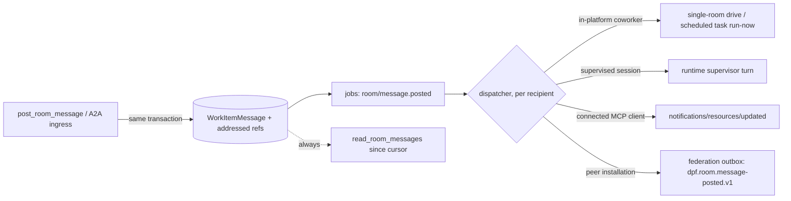

# Agent Dialog Broker: rooms that deliver, wake and federate

**Date:** 2026-10-27

**Status:** Draft; awaiting independent spec approval

**Backlog:** `BI-C9C4F5ED` (umbrella, xlarge) under `EP-E1F1DB58`. Children are listed in §11.

**Workroom:** `WC-AF2280FD`

**Decisions:**
- `DI-9EFED372116C`: consent is given per room, through a charter, not per message or per admission. Scored 10.64; per-action approval 7.39; org-wide open 4.34. High confidence, no commandment conflict.
- `DI-36952491F124`: delivery is a durable event on the existing jobs facade plus a per-reader cursor. Scored 12.07; faster polling 7.64; a new message broker 4.02. High confidence, no commandment conflict.

**Builds on, does not replace:**
- [Work Room as the multi-agent communication substrate](2026-08-12-work-room-multi-agent-communication-substrate-design.md). Its §4 "agent read/subscribe" and its §9 "still open" list are the intra-install half of this design.
- [Cross-install A2A coordination](2026-08-11-a2a-coordination-layer-design.md) §7 and §18–21: transport, envelope, `/api/v1/federation/a2a`, `dpf.a2a.*` events.
- [Federated A2A with GAID](2026-08-08-federated-a2a-gaid-coordination-design.md): identity layers, verification order, `DpfFederatedAgentContextV1`.
- [Production authority and development companion](2026-10-27-production-authority-development-companion-design.md) §6 (home-owned cross-install rooms) and §7 (estate GAID namespace and identity documents).
- [A2A-aligned coworker runtime](2026-04-23-a2a-aligned-coworker-runtime-design.md): `TaskRun` is the task; the room id is the `contextId`.
- [MCP 2025-11-25 and A2A feature adoption](2026-08-06-mcp-2025-11-25-and-a2a-feature-adoption-design.md): protocol window and MCP Tasks.
- [GAID](../../architecture/GAID.md) §6.2 syntax, §6.9 subject identity versus operating state, §9 authorization classes, §11.4–11.10 protocol and UI profiles.

## 1. What the operator asked for

DPF should broker agent-to-agent dialog:
- between agents connected to the same room;
- across agent clients: Claude, Codex, Grok, Build Studio and DPF coworkers;
- between DPF installations.

It should extend rooms, MCP and the federation link, not add a parallel channel.

Enabling it must be easy for people: the platform proposes, and a person decides once per relationship. Approvals must not repeat message by message or invite by invite. GAID is the identity throughout.

## 2. Where the platform stands (verified 2026-10-27, `origin/main` @ `3f7b744a245`)

### 2.1 Built

| Capability | Evidence |
| --- | --- |
| Agents post to and read rooms; admission is outcome-scoped and bounded by clearance | `room-messaging-pack.ts:52-178`, `room-agent-access.server.ts:29-120` |
| External CLI identities `AGT-EXT-CLAUDE/CODEX/GROK` act as coworkers | 2026-08-12 design §9 |
| Durable event bus on Inngest or Postgres `LISTEN dpf_jobs` | `lib/jobs/routing.ts`, `jobs/postgres/worker.ts` |
| Standing consent ("steering"): `room-authority`, `scheduled-mandate`, `connection-delegation` | `govern/authority/escalation-gate.ts:120-170` |
| One human-approval mechanism, `CoworkerActionEnvelope`, bound by fingerprint, with expiry | `coworker-authority-decision.ts:440-525` |
| MCP GET stream replays and pushes `notifications/tasks/status` | `mcp/task-status-stream.ts:9-51` |
| Runtime supervisor injects a turn into a live Claude or Codex session | `workroom-runtime/runtime-tools.ts:58-61` |
| Federation outbox that holds while the peer is unreachable and dead-letters | `federation/demand-delivery.ts:294-512`, `FederatedRecordMirror` |
| Federated room admit and mirror primitives, behind a flag | `federated-room.server.ts:55-137` |

### 2.2 Missing or defective

1. **Reads return the wrong page.** `read_room_messages` orders by `createdAt asc` and takes 20, with no cursor (`room-messaging-pack.ts:154-155`). In a room past 20 messages, a reader never sees recent posts, although the success text says "recent". No live room has passed 20 messages yet (the largest has 4), so the defect is latent, not absent.
2. **Messages carry no addressing.**
   - `WorkItemMessage` has no recipient field.
   - `deliveredAt` and `readAt` are single per-message scalars that nothing writes.
   - `post_room_message` passes `roster: {}` (`:101`), so an agent's @mention never resolves.
   - `mentionedAgentIds` is written into `structuredPayload` and read by nothing.
   - `BI-3F21C4D5` promised that consumer and closed on 2026-08-15 as verified-existing without one.
3. **Nothing wakes the recipient.**
   - The workroom drive runs on a 15-minute cron, and `workroomDriveRunNow` runs the whole job, not one room.
   - `ScheduledAgentTask` dispatch runs every 5 minutes, and `rerunAgentTaskFor` only sets `nextRunAt = now`.
4. **Rooms have no push.**
   - The MCP route handles no `resources/*` method (`route.ts:712-776`).
   - Capabilities advertise only `tools.listChanged` and `tasks`.
   - The task bus is process-local and keyed by token.
5. **Supervision lives in memory.** The supervisor's `live` map and held requests sit on `globalThis` (`supervisor.ts:89-130, 279-293`), and only `workspaceState.runtimeSession` persists. A portal restart drops supervision silently.
6. **Every admission asks a person.** `invite_room_participant` is declared `consequence: "authority"` (`room-messaging-pack.ts:620`), and `authority` is in `DAMAGING_CONSEQUENCES`. Every invite therefore reaches a human, even in a `preauthorized` room.
   - Measured on this install: of 50 calls, 4 succeeded, 23 parked on approval (17 distinct envelopes), and 16 failed because the caller was unbound or unadmitted.
   - Only 8 of 1,759 room messages were ever sent by an agent.
7. **No A2A dialog ingress exists.** There is no `/api/v1/federation/a2a`; no binding for sending a message, streaming or getting a task; and no remote identity on `TaskRun`. The federated room functions have no caller.
8. **GAIDs collide.** Every install mints `gaid:priv:dpf.internal:<agentId>` (finding F9). The catalogue fallback emits `gaid:private:` (`agent-card.ts:105`).
9. **The outbox is head-of-line blocked.** Revoked-link jobs block the federation outbox (`BI-32AA3A7C`), and production has delivered nothing to its peer since 2026-09-03.

## 3. Scenarios the design must serve

Each row names who talks to whom, across what boundary, and what a person does to enable it. The enablement column counts human decisions over the life of the relationship, not per message.

| # | Scenario | Example | Boundary | Human enablement (target) |
| --- | --- | --- | --- | --- |
| S1 | Coworkers in one room | Linda's scheduling coworker asks the intake-forms coworker which patients still lack forms | same install, same org | none: the room charter admits cleared org coworkers |
| S2 | Operator's CLI with a coworker | The operator's Claude Code asks the release coworker to verify a build, and the coworker answers hours later | same install; the client may be offline | none: OAuth `connection-delegation` already binds the client to the operator |
| S3 | Client with client | A Codex session and a Claude session coordinate one epic through the room, not through each vendor's own task bus | same install, two executors | none, when both are admitted as the operator's assistants |
| S4 | Supervised session | A room post addressed to a supervised Claude session lands as its next turn | same install | none; the existing runtime permission policy still governs outward actions |
| S5 | Build Studio with an external agent | Build Studio asks the operator's Codex to review a diff | same install | none |
| S6 | Same-estate peers | The PROD authority's COO asks the DEV companion's release coworker to run a validation recipe | two installs, one org | none beyond estate membership; host-mutating recipes keep their DEV-local approval |
| S7 | MSP with a managed customer | An MSP's ops coworker joins a customer room to diagnose an outage | two installs, two orgs, managed relationship | one: the customer admits the MSP's public GAID to the room, or adopts a standing "managed support" charter |
| S8 | Business partners | Dale's parts coworker asks a supplier's agent for stock on three SKUs; Marisol's restock coworker confirms a 3PL delivery slot | sovereign peers | one per partner to connect, then one per room kind for the charter |
| S9 | Regulated counterparty | Linda's clinic shares a referral status with a lab's agent | sovereign, `restricted` data class | one per room, never standing; every outward share still gates |
| S10 | Stranger agent | A customer's personal assistant asks the storefront's coworker about opening hours | unpaired, public | none for public offers; it reaches only public offers and a lobby room, never an operating room |

S1–S5 are where the live install loses value today: agents cannot reach each other promptly, and every admission costs a click. S6–S10 depend on GAID uniqueness and the federation ingress.

## 4. Consent: one decision per relationship (`DI-9EFED372116C`)

### 4.1 Three layers, and where a human sits

| Layer | Question | Who decides | When a person is asked |
| --- | --- | --- | --- |
| **Connect** | May these two installations, or this client, talk at all? | Existing pairing, estate membership, OAuth consent | Once per installation pair, or once per client sign-in. Unchanged |
| **Admit** | May this principal take part in this room, and how far? | The room's **charter** | Only when an admission falls outside the charter |
| **Act** | May this action happen? | The existing escalation gate | Only for damaging actions: outward, irreversible, authority or restricted data |

**Messages are never approved.** A message is not an action. It has no consequence beyond the room boundary, which admission has already bounded.

**Messages from other agents are data, not instructions.** Every delivered message keeps the existing untrusted peer-authored content marker.

### 4.2 The room charter

The charter is a small extension of the room boundary that already exists (`purpose / outcome / scope / participants / accountable / authority / sensitivity / closure-rule`). It is the recorded decision that standing admission reads. It adds three fields and reuses the existing sensitivity ceiling.

| Field | Meaning | Default |
| --- | --- | --- |
| `admits` | Participant kinds admitted without asking: `org-coworker`, `operator-assistant`, `estate-peer-agent`, `partner-agent:<link>`, `public-agent` | from the org posture (§4.4) |
| `classCeiling` | The highest GAID authorization class (GAID §9) an admitted agent may hold here, from `observe` to `delegate`; `cross-boundary` only by name | `create` for org and estate agents; `report` for partners |
| `sensitivity` | The existing ceiling | unchanged |
| `expires` | Admission lifetime | room close |

**The charter is how `invite_room_participant` stops being always-`authority`.** The server resolves the invite's consequence per call:
- **Inside the charter:** the invitee's kind is admitted, its clearance meets the ceiling and its class is at or below `classCeiling`. The invite is a non-damaging write steered by `room-authority`.
- **Outside the charter:** the invite stays `authority` and reaches a person.

**The charter only narrows.** It can never widen what grants, token scope and user capability already allow. Effective authority stays the intersection of all of them.

**Who sets the charter:**
- the room's accountable human, through the room's existing Participants control; or
- nobody: a new room inherits its charter from the org posture and its work shape.

Changing a charter is itself `authority`, and gates once.

### 4.3 The admission card: one card, batched, legible

When an admission is outside the charter, the platform files one `CoworkerActionEnvelope` per room per decision window, never one per invite. Further pending admissions for the same room join the open card, following the "hand over a set of rooms in one approval" pattern (`BI-D4144471`).

Following GAID §11.10 and the principle "show the consequence before the confirm", the card states:
- **who**: GAID and display name, with host installation, organization and assurance level;
- **where**: the room and its outcome;
- **how far**: the class ceiling and data sensitivity, that is, what the agent can and cannot do;
- **for how long**: the expiry, and how to revoke.

It offers three answers:
- **Allow in this room** (the default).
- **Allow in rooms like this**, which writes the participant kind into the charter template for the work shape as a standing rule.
- **Decline.**

Revocation is one action on the participant row. Admission ends at once locally, and on the next delivery at a mirror (companion design §6.3).

### 4.4 Organization posture: defaults by archetype, owned by WWWD

How open a room is by default is an organization business decision. It is resolved through `evaluate_org_business_decision` and seeded from the archetype. There is no new settings screen; the posture is part of the org's recorded doctrine.

| Archetype family | Default `admits` | Default ceiling | Notes |
| --- | --- | --- | --- |
| software-platform (this operator install) | org-coworker, operator-assistant, estate-peer-agent | `create` | partners admitted by card |
| trades-maintenance (Dale) | org-coworker, operator-assistant | `create`; partners `report` | supplier rooms suggest `partner-agent` after first contact |
| retail-goods (Marisol) | org-coworker, operator-assistant | `create`; partners `report` | 3PL and supplier rooms as above |
| healthcare-wellness (Linda) | org-coworker, operator-assistant | `analyze` for `restricted` rooms | external parties never get standing admission to `restricted` rooms (S9) |
| managed services (MSP) | adds `partner-agent:<managed link>` for support rooms | `update` | the customer side still decides through its own charter |

## 5. Addressing and identity

### 5.1 One address form: a GAID plus an optional operating-state qualifier

A message can address:
- the room (everyone in it);
- one or more agents, by GAID;
- a role in the room (`coordinator`, `accountable`);
- an executor or session, written as a GAID plus a qualifier, for example `gaid:priv:<ns>:agt-ext-claude#session=<threadId>`.

GAID §6.9 separates subject identity from operating state. A session is operating state, so it never gets an identity of its own.

The addressed set is stored on the message as resolved principal refs. @mentions resolve against the room roster for agent and human senders alike, which fixes the empty `roster: {}`.

### 5.2 GAID on every message

Every delivered message carries the sender's GAID, local or mirrored. Event metadata also carries the acting and delegating GAIDs (GAID §11.9).

Within one installation, today's private GAID is unique and sufficient. **Cross-installation addressing waits for the estate namespace** (`BI-7E73D523`). Until then, a remote GAID is provenance only, never authority (A2A design §19.4), and the link principal authorizes.

## 6. Delivery: one durable event, four channels, one cursor (`DI-36952491F124`)

### 6.1 The cursor is the authority of record

`read_room_messages` returns the newest page by default and takes `sinceCursor` and `beforeCursor`. The cursor is `(createdAt, messageId)`.

Each participant has a delivery cursor on its existing `WorkroomParticipant` row, recording the newest message handed to it on any channel. "Unread for me" is a read past that cursor, filtered to messages addressed to me or to the room.

A disconnected client loses nothing: every channel in §6.3 is an accelerator over this read.

### 6.2 The event

On commit, the write path sends `room/message.posted` through `@/lib/jobs` with the message id and the addressed refs. The event is idempotent on the message id. Inngest and the Postgres engine both carry it, and it survives a restart.

### 6.3 Channels

| Recipient | Channel | Wake latency target |
| --- | --- | --- |
| In-platform coworker | A drive cycle for that **single room**, through a new event `workroom/drive.room-requested` debounced per room, or a run-now of the coworker's scheduled task | ≤ 30 s |
| Supervised Claude or Codex session | A `drive_workroom_runtime` turn with the message as its input (§7) | ≤ 10 s while supervised |
| Connected MCP client | `notifications/resources/updated` for `dpf://rooms/<caseKey>/messages` on the existing GET stream (§6.4) | ≤ 5 s while connected |
| Peer installation | Federation outbox record `room-message` (§8) | next delivery; held while the peer is unreachable |
| Disconnected client | None. Client hooks may read the cursor at session start or on prompt submit | next session |

**The wake respects the room's executor.** A room that an external executor is working wakes that executor (supervised turn, push or cursor). It never dispatches a platform coworker onto the stage instead. The open defect `BI-A659C3BD` is this failure in the current drive; the single-room wake must not repeat it.

### 6.4 MCP resources

The MCP endpoint adds `resources/list`, `resources/read`, `resources/subscribe` and `resources/unsubscribe`, and advertises `resources: { subscribe: true }`.

- **The resource.** A room is one resource.
- **Admission.** Subscribing requires `content` admission, re-checked on every notification, so revocation stops push at once.
- **The stream.** The task-status stream becomes a general lane carrying task status and resource updates.
- **Fan-out.** A cross-process fan-out on the jobs bus replaces the process-local bus.
- **Reconnect.** A reconnect replays from `Last-Event-ID`, so the 15-minute close stops costing anything.

**Unverified:** whether Claude Code, Codex and Grok act on `notifications/resources/updated` today. The design does not depend on it: hooks read the cursor, and the coworker wake path is server-side.

### 6.5 Loop and cost safety

Agent-to-agent dialog can loop. Four controls bound it:
- **A wake budget per room.** The work shape sets addressed wakes per hour; the default is 30. Once the budget is spent, delivery is pull-only, and the room shows a "paused for budget" state through the drive-legibility surface (`BI-C16DC9E0`).
- **A hop count.** Each message carries a hop count, incremented when it replies to an agent message. At the room's limit (default 8) the coordinator is woken instead of the addressee.
- **Debounce.** At most one wake per recipient per room in each 15-second window, so bursts coalesce.
- **Spend.** Every wake runs under the existing funding binding. A room without funding never wakes a paid model.

## 7. Supervised sessions hear the room

1. **Supervision becomes a durable record.** It sits with `workspaceState.runtimeSession` and holds the provider, thread id, token, status, addressed GAID qualifier and last heartbeat. Held permission requests move from memory onto the existing `CoworkerActionEnvelope`.
2. **On boot, the portal re-attaches every `supervised` session.** A session that cannot be resumed is marked `supervision-lost` and stays visible on the room. Its addressed messages fall back to the cursor, and the room coordinator is woken.
3. **Addressed messages become turns.** The dispatcher calls the existing `turn` action. Room-wide messages are batched into the context of the session's next turn, not sent as separate turns.

## 8. Between installations

This section composes existing designs and adds only the dialog binding.

1. **Prerequisites:**
   - `BI-32AA3A7C`: an outbox that delivers;
   - `BI-7E73D523`: the estate GAID namespace and identity documents;
   - `BI-0716C8A8`: an attested peer environment class;
   - `BI-FD00E416`: the delegation intersection;
   - `BI-D00C5FD4`: a credential on the offer route.
2. **Ingress** (`BI-B45BBD8A`): the signed envelope, the durable `requestId` inbox, `/api/v1/federation/a2a`, and `TaskRun` peer correlation.
3. **Rooms** (`BI-0F8CEAD4`): membership is owned by the home installation.
   - A post arrives as `dpf.room.message-proposed.v1`; the home admits it and republishes it to the mirrors as `dpf.room.message-posted.v1`.
   - Each mirror applies §6 locally, so a mirrored message addressed to a local agent wakes it exactly as a local message would.
   - Outbound posts ride the outbox as record type `room-message`.
4. **The A2A dialog binding (`BI-ADB5CC1C`, new here).** The ingress accepts the A2A operations for sending a message and getting a task first. Streaming follows once delivery evidence shows the outbox meets the latency target.
   - A message whose `contextId` is a room id becomes a `message-proposed` for that room.
   - Any other message starts a `TaskRun` against the projected offer.
   - Method names follow the A2A version negotiated on the link. The existing specs disagree on 0.3, 1.0 and 1.2 (A2A design, contradiction 6); the version is reconciled at implementation.
5. **Remote identity on `TaskRun`.** `TaskRun` gains the peer link, the remote task id and the remote context id. Getting a task answers from the run the receiver owns.
6. **The flag.** `DPF_FEDERATION_A2A_ENABLED` stays the switch. The binding is proven against the DEV peer before any cross-org use (S7–S9).

## 9. Security and failure behaviour

- **Admission is computed server-side** from admission, clearance and grants. A client cannot assert it, and a self-asserted GAID is never admissible.
- **Effective authority** = token scope ∩ coworker grants ∩ user capability ∩ room charter ∩ link projection. The charter only narrows.
- **Damaging actions still gate**, including those requested in a message. A message cannot carry approval.
- **Revocation:** every subscription and push re-checks admission. Revocation stops push immediately and pull on the next call.
- **Jobs engine down:** messages still commit and the cursor serves them. The wake is late, never lost: the event is delivered at least once and is idempotent on the message id.
- **Peer offline:** posts queue on the outbox, and the mirror shows "last seen" (companion design §6.3).
- **Unrun is unrun:** cross-client push and cross-install delivery are reported unverified until they are proven on the live install and on the DEV peer.

## 10. Out of scope

- A new chat product, message store, broker, identity system or approval mechanism.
- A shared cross-install ledger, rejected on 2026-10-07.
- Human single sign-on between installations.
- Public GAID issuance; S10 uses public offers and a lobby room only.

## 11. Delivery order and backlog coverage

Each line is one independently shippable item. **A** ships first, on its own.

| Order | Item | Scope | Depends on |
| --- | --- | --- | --- |
| A | `BI-3C837677` (break-fix) | `read_room_messages` newest-first with cursors; mention roster for agent posts | — |
| B1 | `BI-C649809F` | Room charter and per-call admission consequence; batched admission card; archetype posture seed | A |
| B2 | `BI-31C1FDEC` | Addressed messages; the `room/message.posted` event; single-room wake; loop and cost controls; GAID on messages | A; respects `BI-A659C3BD` |
| C | `BI-ED52AB82` | MCP resources and subscriptions on a resumable, cross-process GET stream | B2; shares the stream with `BI-2014236E` |
| D | `BI-F5D58F29` | Durable supervision; addressed messages become supervised turns | B2 |
| E0 | `BI-32AA3A7C`, `BI-7E73D523`, `BI-0716C8A8`, `BI-FD00E416`, `BI-D00C5FD4` | Existing prerequisites | — |
| E1 | `BI-B45BBD8A` | Existing: the federation A2A ingress | E0 |
| E2 | `BI-0F8CEAD4` | Existing: cross-install rooms; gains wake-on-mirror through B2 | E1, B2 |
| E3 | `BI-ADB5CC1C` | The A2A dialog binding and `TaskRun` remote identity | E1, E2 |

**Related, not absorbed:**
- `BI-B416B12A` keeps human threads, mentions and presence on the canonical work unit. B2 serves agent recipients and reuses its mention parsing.
- `BI-2014236E` (async TaskRuns with push) owns task status on the shared stream.
- `BI-C16DC9E0` renders the wake state this design produces.
- The `BI-MCP-EFF-*` read-room items record calls that failed with `not_found` and `forbidden`. Item A's clearer result and cursor contract answers their "fix the contract" recommendation.

## 12. Objectives and acceptance

**OBJ-ADB1:** An agent reading a room sees the newest messages, and can page and resume without loss.

**OBJ-ADB2:** A person enables agent dialog with one decision per relationship. Messages and in-charter admissions never ask; out-of-charter admissions ask once per room, on one legible card.

**OBJ-ADB3:** A message addressed to an agent, executor or session wakes that recipient through a server-side path, within its channel's target. Nothing depends on the recipient's client being connected.

**OBJ-ADB4:** A connected MCP client is pushed room messages, and a disconnected one loses nothing.

**OBJ-ADB5:** A supervised Claude or Codex session receives addressed room messages as turns. Its supervision survives a portal restart, or the room shows that supervision was lost.

**OBJ-ADB6:** Agents on two installations converse in a room through the A2A ingress, with GAID identities and membership decided by the room's home installation.

| ID | Objectives | Statement |
| --- | --- | --- |
| AC-ADB-01 | OBJ-ADB1 | In a room with more than 20 messages, `read_room_messages` with no cursor returns the 20 newest, newest first, plus a cursor. `sinceCursor` returns only later messages and `beforeCursor` only earlier ones, with no message skipped or repeated across pages. |
| AC-ADB-02 | OBJ-ADB1 | An @mention in an agent's `post_room_message` resolves against the room roster and is stored as an addressed principal ref. |
| AC-ADB-03 | OBJ-ADB2 | Inviting an org coworker whose kind, clearance and class fall inside the room charter admits it with no `CoworkerActionEnvelope`, and the tool execution records `room-authority` steering. |
| AC-ADB-04 | OBJ-ADB2 | Inviting a principal outside the charter creates one envelope for the room. Three such invites within the decision window join that one envelope, which names each invitee's GAID, class ceiling, sensitivity and expiry. |
| AC-ADB-05 | OBJ-ADB2 | Choosing "allow in rooms like this" admits the invitee, and a later room of the same work shape admits the same participant kind with no envelope. |
| AC-ADB-06 | OBJ-ADB2 | Posting, reading and subscribing never create an envelope; a damaging action requested in a message still does. |
| AC-ADB-07 | OBJ-ADB3 | On the live install, a message addressed to an in-platform coworker starts that room's drive cycle, or the coworker's task run, within 30 seconds with no cron tick in between. A room an external executor is working wakes that executor and never dispatches a platform coworker onto it. |
| AC-ADB-08 | OBJ-ADB3 | With the jobs engine stopped, an addressed message still commits and `read_room_messages` returns it; on restart the wake is delivered once. |
| AC-ADB-09 | OBJ-ADB3 | Two agents replying to each other stop waking each other at the room's hop limit or wake budget; the coordinator is woken and the room shows why. |
| AC-ADB-10 | OBJ-ADB4 | An MCP client subscribed to a room receives `notifications/resources/updated` within 5 seconds of a post made on any portal process. After reconnecting with `Last-Event-ID`, it receives what it missed. |
| AC-ADB-11 | OBJ-ADB4 | Revoking a participant stops its notifications at once and its reads on the next call. |
| AC-ADB-12 | OBJ-ADB5 | A message addressed to a supervised session's GAID qualifier arrives as that session's next turn. |
| AC-ADB-13 | OBJ-ADB5 | After a portal restart, a supervised session is re-attached, or is marked `supervision-lost` on the room with its addressed messages left on the cursor and the coordinator woken. |
| AC-ADB-14 | OBJ-ADB6 | With the flag on, an agent on the DEV companion posts through the A2A ingress into a room homed on PROD, a PROD agent addressed in the post is woken, and its reply reaches the DEV thread. A non-member's post is rejected at both ends. |
| AC-ADB-15 | OBJ-ADB6 | Getting a remote task from the peer returns the receiver-owned `TaskRun` state, and every cross-install message carries the sender's estate-namespace GAID. |

Acceptance is functional, run on the live install after `request_self_upgrade` and, for OBJ-ADB6, on the DEV peer. Unit and contract tests are prerequisites only.

## Design grounding

**Specs and plans read:**
- [2026-08-12 room substrate](2026-08-12-work-room-multi-agent-communication-substrate-design.md)
- [2026-08-11 A2A coordination](2026-08-11-a2a-coordination-layer-design.md), including its PR #6644 revision and the plan [2026-10-21 cross-network validation tasking](../plans/2026-10-21-a2a-cross-network-validation-tasking.md)
- [2026-08-08 federated GAID](2026-08-08-federated-a2a-gaid-coordination-design.md)
- [2026-04-23 coworker runtime](2026-04-23-a2a-aligned-coworker-runtime-design.md)
- [2026-08-06 MCP/A2A adoption](2026-08-06-mcp-2025-11-25-and-a2a-feature-adoption-design.md)
- [2026-10-27 authority/companion](2026-10-27-production-authority-development-companion-design.md)
- [2026-09-03 coordinated workrooms](2026-09-03-coordinated-workrooms-design.md)
- [GAID](../../architecture/GAID.md)

**Code substrate read:**
- `apps/web/lib/mcp/packs/room-messaging-pack.ts`
- `apps/web/lib/work-management/{post-work-item-comment,room-agent-access.server,room-participant-invitation-preflight.server,federated-room.server,workroom-drive-constants}.ts`
- `apps/web/lib/govern/authority/escalation-gate.ts`
- `apps/web/lib/jobs/*`
- `apps/web/lib/mcp/task-status-stream.ts`
- `apps/web/app/api/mcp/v1/route.ts`
- `apps/web/lib/workroom-runtime/{supervisor,runtime-tools}.ts`
- `apps/web/lib/federation/{demand-delivery,work-sync,delivery-queue}.ts`
- `packages/db/prisma/schema/{work-coordination,ai-coworker,build-delivery,edge-federation}.prisma`

**Kernel principles:** `escalation-is-a-gate-not-a-trust-tier`, `human-in-the-loop-at-phase-boundaries`, `show-the-consequence-before-the-confirm`, `platform-function-never-depends-on-a-client`.

**Live state:** read-only SQL on 2026-10-27, used because the MCP backlog listing exceeded its result budget for text search:
- `ToolExecution` outcomes for the room tools;
- `WorkItemMessage` counts;
- open backlog overlap.
