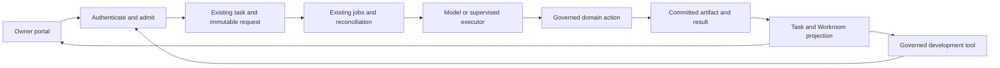

# Complete the agent execution journey

**Research/design owner:** BI-1FDAA62B / WC-C44D18D5. **Executable proof:** BI-7DC3B91D.
**Plan:** [phased delivery](../plans/2026-10-29-agent-execution-conformance-plan.md).
**Extends, does not replace:** [common recovery contract §5.1](../../architecture/2026-06-09-long-running-agentic-process-architecture.md), [durable delegation](2026-10-07-durable-delegation-ledger-design.md), [job engine](2026-09-25-postgres-durable-job-engine-design.md).
**Authority:** founder requested research and a solid repair plan on 29 October 2026. This document does not approve implementation, spending, access changes or customer promises.

## Owner decision summary

DPF has substantial execution infrastructure and useful source repairs. It has not demonstrated the complete development and business journeys reviewed here. Complete the connections between existing components, test them as a system, then remove superseded paths. Do not start another engine project.

The immediate sequence is: authenticated saving; retained foreground work; actual reviewer execution/result return; interruption recovery; one complete development change; one business job. Each phase must expose its remaining limit rather than borrowing a pass from another phase. The owner should see the result, a specific wait, or a decision they can actually make—not a technical troubleshooting assignment.

## Task brief and evidence limits

Objective: explain recurring execution failures and specify a verifiable convergence plan. Scope: portal/MCP ingress, authenticated domain writers, TaskRun/job dispatch, reviewer/child return, recovery and visible results. Procedure: DPF systematic debugging, existing architecture/substrate, comparative primary-source research and WWMD consultation. Evidence: live backlog/readiness records, previously observed owner failures, source at `1f8c111c409a4e8cc3575d118a7a154134791ba9`, and individually named unmerged repairs. Stop condition for this design task: versioned research/design, mapped plan, recorded uncertainty and a review/publication handoff. A document cannot satisfy runtime acceptance.

The latest canonical preflight in this chat served `4718cd4f1c5418ab2eba819dd47d5cb839f8eca0`; it did not contain marketing merge `07e911cb01bc41c3185ab3ea71ace51d70f4ca92`. Source identity, delivery and served identity are separate. Live observations below were recorded during the CEO walkthrough or by the named repair chat; source analysis explains a boundary but does not independently replay it on deployed bytes. The four-month history is not an exhaustive incident census.

## 1. Why the problem recurs

| Evidence | What it establishes | What it does not establish |
|---|---|---|
| June architecture already prescribed journaled work, visible status and restart proof; October delegation design identified eight mechanisms | The direction was already understood; another abstract durability principle is insufficient | Every adapter adopted it or passed the planned tests |
| Current `app/api/agent/send/route.ts` saves a message, returns processing, then invokes `sendMessage` in an unawaited process closure | Accepted message persistence is stronger than retained execution; a live request can depend on its serving process | That the observed provider-busy failures were caused by process death |
| BI-801313EB completed async operation work while explicitly preserving synchronous routes | A completed infrastructure slice may leave the owner route unchanged by design | That its completed implementation should be reopened or discarded |
| Native capture passes tool eligibility, then `ux-critique-pack` → `critique-entry` → `saveWikiOverlayEdit` → `requireUser/auth()` | The traced tool-to-domain boundary depends on browser authentication; BI-A615654F owns its repair | That more coworker grants will fix this mismatch |
| CE-EB8821DD remains requested without a result; fulfillment returns a grant-intersection refusal | The request has not become an executed review | Which exact intersection condition is missing; that denial is an outage |
| `agent-child-thread-run.ts` declares process-bound recovery with no engine retry | Lost execution fails visibly and informs its parent; that is intentional safe behavior | Automatic successful continuation of the interrupted job |
| `critique-entry.test.ts` stubs the save action with success | That suite does not exercise the failing authentication/persistence boundary | That all tests are mocked or all review paths fail |
| Source fixes, merged work and the running image differ | A passed source check is not a passed owner workflow | That deployment alone will correct every remaining defect |

Working diagnosis: incomplete adapter convergence, cross-boundary verification gaps and unresolved execution/review dependencies allow local improvements without a reliable overall journey. This is an inference supported by the boundaries above, not a measured ranking of every incident's cause. Provider availability, model quality, cost and actual grant intersections need their own exact trace; do not explain them with a generic “busy” message.

### Historical reconciliation

Keep the June recovery contract as doctrine. BI-CB690D61 records its prior delivered documentation; the current BI-1FDAA62B mirror is used here for the explicitly requested research/convergence follow-up, not a claim that doctrine never existed. Preserve BI-801313EB's completed async scope. Keep October delegation owners and the current foreground/authentication fixes. Do not implement a `WorkroomCommandReceipt` table from older draft prose: current `work-capsules/command-receipts.ts` stores receipts in the existing WorkroomActivity transaction. Source/schema wins over that obsolete proposed table. Preserve older evidence and identify actual failed behavior with corrective BIs; do not rewrite historical passes or reopen delivered work merely to demand new acceptance.

## 2. Research & Benchmarking

Primary sources checked 29–30 October 2026 UTC. These are source/document comparisons, not controlled production reliability benchmarks. No comparator was installed or adopted.

| Comparator | Pattern to use | Boundary or rejected transfer |
|---|---|---|
| [t3code orchestration](https://github.com/pingdotgg/t3code/blob/main/docs/orchestration-v2/orchestrator-mcp-server.md) and [ThreadManagementService](https://github.com/pingdotgg/t3code/blob/main/apps/server/src/orchestration-v2/ThreadManagementService.ts) | WebSocket and MCP enter a shared application service. Its send contract returns the actual run/message/projection and delivery disposition. Retried request keys retain identity; waits report durable status without canceling work. Its documented integration test uses real registration, orchestration, SQL and projections, substituting external providers. | DPF already studied T3 in September/October. Reuse those findings; do not copy its SQLite/Effect runtime or weaken DPF tenant, grant or business-effect controls. This review does not prove T3 is bug-free. Source blob for service excerpts: `7b79b21e881533a431379f678c7492a78da9770f`. |
| [Temporal execution](https://docs.temporal.io/workflow-execution), [workflow/run identity](https://docs.temporal.io/workflow-execution/workflowid-runid) | Persistent execution history and separate business workflow versus attempt identity make failure/replay explicit. | Use this as a durability reference, including its commercial Cloud offering; do not introduce Temporal alongside DPF's owned job facade or infer exactly-once external effects from workflow replay. |
| [BMAD Method](https://bmadcode.com/method) | Scale rigor to work; hand off durable artifacts and verify against requirements. | Method and artifacts are not a server execution engine. Retain the [existing dependency evaluation](../../security/tool-evaluations/2026-09-15-bmad-method.md); no installed second workflow or rule corpus. |
| [Cursor Cloud Agents](https://cursor.com/docs/cloud-agent) | Prepared isolated execution environments, source branches and inspectable verification artifacts support a complete coding loop. | DPF must prove its shared governed preview is usable. Do not infer that creating a VM/container, or a successful test stub, proves environment readiness; do not adopt cloud hosting as a new dependency. |
| [Linear agent interaction](https://linear.app/developers/agent-interaction) | A task session has explicit pending, active, input, error, complete and stale states linked to visible activities. | Reuse DPF TaskRun and current status vocabulary; do not create another session/status table or treat an activity as a completed requested outcome. |
| [Claude Agent SDK sessions](https://code.claude.com/docs/en/agent-sdk/sessions), [effective agents](https://www.anthropic.com/research/building-effective-agents) | Resume an exact provider session when supported; persist application results separately. Prefer simple explicit workflows for predictable control. | A transcript or provider session is not DPF's authority, task journal or side-effect ledger. Preserve DPF-owned work identity across provider/session replacement. No provider pinning or higher model spend is selected. |

Standards alignment: retain existing MCP authentication/context contracts, A2A-aligned TaskRun states and the repository's governed action boundary. Transactional receipt/outbox and idempotent-consumer patterns are already represented by the October design. No new normative standard or conformance claim is proposed.

## 3. Direction decision

Options: (A) finish shared execution contracts and add cross-boundary proof; (B) continue isolated fixes with existing separate paths; (C) replace orchestration with a T3/Temporal-derived runtime. B wins immediate individual-fix speed and smaller local change scope. C offers established runtime mechanisms but requires extensive DPF authority, business-effect, persistence and deployment translation. A preserves the existing investment while requiring measurable convergence and deletion of retired paths.

WWMD `DI-6A05E518B86D` recommended A, high confidence, autonomy-eligible, no commandment conflict. Principal contributors: absorb existing patterns, research/standards, grounding in current substrate and one source of truth. Feature values were author planning estimates, not benchmark results. Recorded agent choice is **design-only convergence**; the consultation is not an independent design approval, a runtime pass or permission to expand spend/access.

## 4. Binding execution boundaries for the proposed repair

### One logical request, existing authoritative stores

This is a logical flow, not a proposal that all domain tools must become asynchronous. A short action may stay synchronous, but its result and authorization must remain correct when its caller has no browser cookie. Durable task acceptance must commit enough request/dispatch state before acknowledging that work is retained. A missed wake is repaired by existing reconciliation; transient event delivery is never the only record.

| Responsibility | Existing owner/store | Required boundary |
|---|---|---|
| Business objective/accountability | WorkItem/Workroom and current ownership | Remains stable when executor or credential changes |
| Accepted execution | TaskRun, AgentMessage/TaskMessage | Immutable request association; exact public/row identifiers resolved by existing helpers, never interchanged |
| Dispatch, wait, attempts | jobs facade, JobRun/JobStep/JobWait, AsyncInferenceOp where applicable | Durable wake/recovery; one bounded budget across attempts; engine selection remains existing policy |
| Commands and effects | ToolExecution, current WorkroomActivity receipts, domain writer | Current authority, atomic local effect/result where possible; uncertain remote outcome reconciled before replay |
| Result and observation | TaskArtifact/domain document revision, task/workroom projection | Actual stored result associated with the exact request; SSE only invalidates/reveals committed state |

### Authentication and tool usability

Transport adapters authenticate; a shared server-only domain service receives a verified principal and scoped context. Browser wrappers may resolve sessions, but domain persistence must not read ambient browser auth. MCP arguments cannot choose actor, tenant, founder verdict or publication authority. Keep existing capability/grant intersection, kernel protection and author/reviewer separation. Missing, revoked or mismatched server authority refuses before persistence. Unsupported actor/org/status/verdict fields may be rejected or ignored according to the existing tool contract; if ignored, only a permitted draft under the real caller may save. The invariant is zero unauthorized effects, not zero writes for every otherwise authorized request containing an unsupported field. Model-facing tool descriptions must state required inputs, side effects and supported recovery; a refusal returns the exact missing prerequisite and owning remedy without exposing secrets.

### Reasoning and execution

Keep the model responsible for analysis and bounded tool choice. The server owns acceptance, scope, dispatch, retries, cancellation, result association and completion. Preserve current CLI/runtime adapters rather than rebuilding coding intelligence. A reviewer request must be distinguished from its admitted TaskRun, executed contribution, persisted receipt and satisfied gate. Record each separately; do not use a request count or chat assurance as evidence that a reviewer ran.

### Recovery and no duplicate effects

Follow §5.1, not a second state machine. Repeated delivery of the same authenticated immutable request returns its existing result or current disposition; changed intent is distinct. Revalidate authorization on resume. Replay only operations whose effect safety is established. A process-bound step may fail visibly, then a separately authorized successor resumes from durable artifacts/provider context; do not replay an arbitrary agent turn. If effect outcome is unknown, retain uncertainty until readback or explicit reconciliation. Receipt replay itself must recheck current read/content authority and must not disclose a prior result after access was revoked.

Original review settlement needs an explicit negative control: the expense review was reported input-required with expired budget, current authority, executing=false and pollUseful=false; listed nodes were completed with unknown/not-dispatched outcomes and no unresolved node IDs, while executionSettled=false and missing-current-proof remained. Neither inactivity, a completed node label nor an empty unresolved list proves a terminal effect. Use existing request-digest/room/node-bound reconciliation and required fresh health evidence before any authorized successor. Preserve aggregate attempt limits; current authority and remaining attempts alone do not authorize a replacement inference.

Preserve the October 13 founder choice in BI-AD979E79: general parent auto-continuation is optional and off by default. Returning a child result and making its wait visible do not authorize a new model turn. Any eligible bound workflow continuation must use its existing standing scope; off/closed/cancelled parents stay stopped. No global automatic enablement belongs in this plan.

### Owner experience

One summary first: result or specific wait, business consequence, responsible next actor, and one supported action if the owner must decide. The saved artifact opens directly. IDs, provider traces, receipts and history are disclosed on demand. “Saved” means persisted; accepted but queued/admitted work remains waiting; “working” needs actual execution/liveness evidence from the existing projection; “complete” requires the requested deliverable. Admission or a lease alone cannot imply progress. An unavailable reviewer is a specialist/platform task, not a request for the owner to guess a grant. OAuth/credentials, material scope changes and genuinely consequential decisions retain human gates.

## 5. Objectives and acceptance

**OBJ-EXEC-AUTH:** Authorized portal and native tools use equivalent domain authorization and persistence without sharing a browser session.

**OBJ-EXEC-WORK:** Accepted work has durable identity, executable dispatch and a result tied to the original request.

**OBJ-EXEC-RECOVER:** Interruptions retain bounded recovery, current authority and no duplicate effects.

**OBJ-EXEC-UX:** A nontechnical owner can find the actual result or supported next action without investigating internals.

**OBJ-EXEC-DELIVER:** One development journey and one business journey work on qualified served bytes; retired paths cannot silently regain authority.

| Acceptance ID | Objective IDs | Statement |
|---|---|---|
| AC-EXEC-01 | OBJ-EXEC-AUTH | Actual no-cookie MCP ingress saves a permitted draft, read back by its owner. Missing/revoked/mismatched server authority writes nothing. Caller fields cannot impersonate an actor, cross an organization boundary, mint a human verdict or change protected content; accepted sanitized drafts remain real-caller/organization-scoped and agent-proposed. |
| AC-EXEC-02 | OBJ-EXEC-WORK | Submit, repeat the same request, lose the response and reconnect: one logical job and one intended artifact result; accepted status only follows durable admission. |
| AC-EXEC-03 | OBJ-EXEC-WORK, OBJ-EXEC-RECOVER | Reviewer request either admits the exact eligible execution and returns its contribution, or shows the precise pending/denied condition. Parent result delivery/continuation obeys its configured policy and existing authority. |
| AC-EXEC-04 | OBJ-EXEC-RECOVER | Kill caller/worker after acceptance, before dispatch, during inference and after effect commit; each reconciles or reaches a safe explicit disposition. Duplicates/stale leases cannot repeat or overwrite committed effects. |
| AC-EXEC-05 | OBJ-EXEC-RECOVER | Provider outage, budget exhaustion, token rotation, revocation and cancel retain request identity, total retry/deadline limits and actual next actor. Unknown remote effect never blindly replays. |
| AC-EXEC-06 | OBJ-EXEC-UX | Refresh/new authorized session shows canonical state and directly opens the same result. Normal work needs no owner technical rescue; denial cannot look like an empty or successful result. |
| AC-EXEC-07 | OBJ-EXEC-DELIVER | An identified nonproduction development fixture runs request→small source fix→affected tests→real independent review→protected PR→governed deployment→served verification. External publication/production changes use their normal authority, not fixture bypass. |
| AC-EXEC-08 | OBJ-EXEC-DELIVER, OBJ-EXEC-UX | A bounded internal business document job completes through the same acceptance/result contract. Later authorized real operator-company mail→owned work→reply draft passes under the Mailroom owner; no synthetic mail is represented as a prospect result. |
| AC-EXEC-09 | OBJ-EXEC-DELIVER | Existing alternatives are inventoried and explicitly retained, narrowed or removed. Source, merged and served evidence remain separately labelled; no documentation-only PR claims to deliver these runtime objectives. |

Advisory review of initial commit `430ee1008859b02feca7ee5f4489412a91141227` by the existing owner-workflow repair chat identified admission-versus-liveness ambiguity, overly broad zero-write wording, and the missing original-review settlement case. These were corrected here. This is a separately attributed advisory assessment, not a canonical independent spec-approval receipt or runtime evidence.

## 6. Verification, release and rollback

### Architecture alignment and scale boundary

Reuse Organization/Principal identity and the existing domain foreign keys; task IDs, job attempts and provider handles are references to different facts, not interchangeable sources of truth. Progress projections may denormalize committed facts for reading but cannot independently decide completion. No table, status enum, provider or deployment service is added by this design task. Implementation keeps the [deployment contracts](2026-05-09-deployment-contracts.md), existing image identity, migration/convergence and governed self-upgrade boundaries. The concrete blast radius is the named entry adapters, shared writers, dispatch/result association, observation and their tests—not unrelated business-domain behavior.

Initial qualification is one organization on one canonical/shared verification target, with one active fixture lease and existing bounded child/concurrency policies. It does not prove readiness for an MSP's 60 customer estates or many sovereign installs. Resume reads must use indexed exact task/room identity or cursor-bounded activity; reconciliation batches must use existing limits/cursors and isolate poison records. No full-inventory-per-turn read or cross-install mesh polling. P0 inventories actual batch/concurrency defaults; P4 adds a bounded backlog/duplicate-delivery case to prove unrelated eligible work still progresses. EP-07B49BD8 owns delegation scale; EP-8DC217EB owns queue/runtime capacity. Higher-volume or multi-install claims require their own measured evidence; this phase creates no new scale epic.

BI-7DC3B91D extends existing integration and fault-injection tests. Use the real transport registration/authentication, domain writers, Postgres transactions, job handling and read projections. Only external providers are deterministic substitutes in that layer. Separately run a bounded allowed-model smoke; absence of credentials, capacity or approved data routing is unrun/inconclusive, not a simulated pass. Keep real negative grant/tenant controls. Screenshots and stored readback accompany owner paths.

Register those cases in the existing test inventory and diff-impact/evidence planner so a change to the covered entry, authority, dispatch, result writer or recovery path selects the corresponding conformance journey. This extends existing CI/gate selection, not a new approval step for every task. A missing test database, skipped required case or unproven adapter leaves that selected boundary inconclusive; a large passing unit-test count cannot replace its result. The integration evidence must report expected versus actually executed required cases.

Proposed qualification sample: 20 consecutive controlled complete journeys across portal/MCP, including the interruption matrix, with zero duplicate effects, false completions or routine owner rescue. Record p50/p95 acknowledgment and completion, queue delay, recovery duration and actual inference cost; do not invent production SLOs or buy capacity to hit an unmeasured target. Follow with seven days of observation of real permitted work. These are proposed release-evidence criteria, not a statistical reliability guarantee or new universal gate on unrelated work.

Each slice follows its existing proportional gates. Independent security/architecture/design review is owed where that slice changes those contracts. Tests cannot turn a permission denial into admission. Broken review infrastructure uses the checked-in recovery route and records exactly which reviews did not run; no self-issued approval. Shared preview/canonical runtime identities and fixture expiry are retained. Existing and fresh-install convergence are checked where configuration/schema changes; no schema migration is selected by this documentation change.

Roll out one entry path at a time on its existing routing/switch seam. Reconcile in-flight/unknown work before switching; preserve receipt and artifact history. A rollback may stop new admissions or restore a known adapter, but may not replay previously committed effects, reset budgets, discard results or restore revoked authority. Remove obsolete execution paths only after their replacement passes AC-EXEC-01–09 for the applicable scope. Track shipped defect fixes separately from this owner-reported readiness assessment, consistent with current backlog closure policy.

## 7. Open facts to resolve before implementation acceptance

- Exact grant-intersection reason for the original reviewer; do not widen permissions speculatively.
- Actual served job-engine selection, scheduling flags, task/child adapters and available runtime/provider capacity; do not infer from seed/defaults or completed BI labels.
- Provider-specific resume behavior and effect reconciliation on the selected live runtime; transcript resumability alone is insufficient.
- Shared preview startup/session isolation and authenticated owner readback.
- Funding scope is unresolved on this design Workroom; no budget allocation or paid provider expansion was inferred.
- Independent design/architecture approval and executable plan coverage are pending. This draft and its planning decision provide no runtime pass.

## 8. Finance worker persistence slice

BI-7DC3B91D / WC-74FD2A42 extends P4 with
`apps/web/lib/agent/foreground-work-finance.postgres.test.ts`. The conformance
branch inherits the frozen foreground implementation7aa through a normal merge;
BI-D0D2FF0D retains that implementation and its UI/publication obligations.
This inheritance is a source dependency, not delivery or acceptance of that repair.

The five new cases use the existing isolated PostgreSQL fixture, real retained
worker, request digest, publication transaction and current membership lookup.
They cover capacity wait followed by competing deliveries and one stored result,
user deactivation, changed thread ownership, committed publication followed by
acknowledgement loss, and changed request content. Explicit governed test
database URLs or the admitted canonical local-CI slot enable them. The latter
requires its existing NPEL admission marker and a PostgreSQL URL whose database
name matches `dpf_local_ci_<number>`. Ordinary install DATABASE_URL values never
enable the suite. This reuses the existing calibration qualification convention.
Fixture teardown removes its unique schema, never public rows.

The coworker turn, job wake transport and event bus remain controlled doubles.
These cases can establish worker/database composition only. They cannot earn a
portal-authentication, actual queue, provider, Finance-tool or full business
acceptance pass. The exact Finance Spend served scenario remains required:
one fresh read-only request, controlled provider busy, retained original job,
server continuation without owner resend, no duplicated effects and genuine
stored-result reload. Historical uncertain jobs are not replayed.

At the initial source checkpoint,32 existing worker/context/adapter cases passed;
the five new PostgreSQL cases were collected but skipped without a governed SQL
target. They are UNRUN, not passed or first-red evidence. Actual execution and a
mutation control must precede a database qualification claim. This slice does
not resolve the rest of P4–P6 or the original specialist-review obligations.

The subsequent admitted SQL check ran source
`58ca8fbd9f20e08c7ea3e540f3d3ab1ba4a5b682` against the disposable PostgreSQL
target of `NPEL-DA14C613EA` on 1 November 2026, 04:12:48–04:12:50 UTC:
five database cases and three target-selection controls passed, none skipped.
The preview source was `7aa31f6ea021a91ae93a9971135a8264398b77a6`;
the worker, context, publication, digest and complete Prisma schema were verified
byte-identical to the test source. This qualifies that composition, not the
entire served preview or a new runtime image.

A test-only authority-lookup mutation then made the revoked-user case fail
(`responded` instead of `blocked`). Restoring the exact test file produced
eight passes again at 04:22:09 UTC. Both fixture runs completed teardown before
the normal preview release at 04:24:20 UTC. The separate served Finance request
remained submitted without a coworker result: that preview had no background
wake transport. Controlled provider-busy recovery and full business acceptance
remain unrun. Native Workroom evidence retains the commands and source/lease
identities; these narrow SQL results do not establish actual provider execution.
### Served retained-work qualification

The SQL fixture still replaces the coworker turn and wake transport. The next
bounded slice uses an optional `foreground-recovery` mode of the existing
GitHub UX runtime: its canonical production bundle, disposable PostgreSQL and
normal authenticated browser. The normal boot starts the existing owned
PostgreSQL engine for `agent/foreground-work-run` and `agent/task-dispatch`.
The latter keeps its actual five-minute reconciliation schedule. A loopback
OpenAI-compatible fixture is the only simulated execution boundary.

One synthetic main-room request must be durably acknowledged, survive a
provider-capacity wait and reload, resume without another submission, and save
one correctly linked response. Repeating the original authenticated HTTP
request must reuse its message and job. Record current request/job/result,
source and production-build identity, observed queue transitions, actual
provider requests, stored response provenance, screenshots and cleanup.
This proves the controlled path; real model quality, Finance tools, real mail
and customer isolation retain their separate acceptance obligations.

Fixture writes require explicit scenario opt-in, the existing exact GitHub CI
database/origin boundary and current source/run binding. Configured provider
credentials, unrelated retained jobs and identity collisions refuse setup.
Only synthetic provider/account/model rows are enabled; their manual scores
are test inputs, never real calibration evidence. Preserve original state and
clean up only owned fixtures after work settles. A measurement boot does not
qualify background execution, so this mode uses normal boot and reports its
own evidence instead of claiming a route sweep.

This expands the existing Small test slice to Medium, admitted by
IRD-55A6228E4398 after plan admission IRD-E74F3BA0F3A8. Funding remains
unresolved; it introduces no paid model, allocation decision or provider
subscription. Existing Large business-review baselines remain unchanged.
The installed Next.js Playwright guide and
[official testing guide](https://nextjs.org/docs/app/guides/testing/playwright)
support exercising the served production bundle.

The first independent CLIENT review raised three harness blockers. Isolation
must include latent proactivity facts and live room cadences, not just existing
tasks. Duplicate submission must await its actual event fanout and queue run;
a fixed delay does not prove processing. Cleanup must establish terminal task
and queue state before restoring provider configuration. Uncertain submissions
or unsettled execution preserve fixture rows and fail qualification. The normal
owner cancellation endpoint is available for a known unfinished fixture; it
does not authorize changing task status directly.

The CI launch uses the existing DEPLOYED_SHA metadata only after the exact-source
artifact is validated or that checkout's production build completes. The test
also checks compiled route bytes and a served static asset. This is provenance
for the controlled CI bundle, not proof of a deployed install or an image label
by itself. An absent or mismatched served source fails qualification.

Partial Postgres routing also delivers events to the existing Inngest adapter.
This CI mode therefore starts the repository-pinned Inngest v1.36.0 backend
inside the same disposable runner. Discovery, polling and portal self-sync are
disabled; no Inngest apps are registered. Only the two selected Postgres
functions execute. This reuses the existing coexistence engine rather than
mocking the wake boundary or adding a platform service. The owned container is
bounded to one CPU/1 GB, loopback-only and removed by the always cleanup step.
The test rejects a completed cron whose reconciliation output is unavailable
or inspected no retained work. See the [vendor Docker procedure](https://www.inngest.com/docs/local-development/docker)
and [pinned CLI flags](https://github.com/inngest/inngest/blob/v1.36.0/cmd/devserver/cmd.go).
